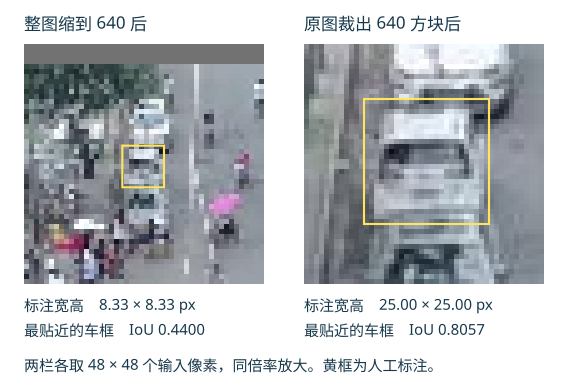

# 第一篇 · 用 SAHI 查小车缩小后还剩多少细节

接着 [one-car 的第 65 行标注](../one-car/README.md)往下查。上一张图把预测框画回原图，方便判断框得准不准。这次把同一辆车在**进入 YOLO11s 时**的样子并排放大。要回答的问题是：同一份权重看整图时漏掉的车，在保留原始像素的那一块里，能否单独报出一个位置合格的 `car` 框？如果单块也漏掉，这个案例就不支持这条解释。



先看黄框。两边各截取模型输入中的 **48 × 48 像素**，在屏幕上都放大五倍。左边的车在输入中只占 **8.33 × 8.33** 像素，右边占 **25 × 25** 像素。右边保留的车身宽、高各是左边的 3 倍，标注覆盖的几何面积是 9 倍。

## 带着一个问题读论文

读 SAHI 原文 **Fig. 2**，先顺着切片推理那条线走。高分辨率原图先切成有重叠的小块，每块交给同一个检测器。小车在局部输入中占的像素更多。检测框加上块的左上角坐标，就能放回原图；相邻块和附加的整图视图可能多次报出同一辆车，最后按类别去重。图中还有用裁片微调权重的训练路径，本例只开关推理视图，两路都用同一份 `best.pt`。[论文 Fig. 2 和 Table 1](https://arxiv.org/pdf/2202.06934v5) · [整图结构图](../../../docs/reproduce/sahi/full-inference-architecture.svg) · [切片结构图](../../../docs/reproduce/sahi/sahi-architecture.svg)

再读 **Table 1** 中普通训练的 TOOD 行。作者在 VisDrone **test-dev** 上，将整图 FI 换成 SAHI+FI+PO，小目标 **AP50** 从 **18.1 升到 23.8**。这支持沿着输入尺度排查。表中的汇总指标无法告诉我们某辆车的候选消失在哪一步，因此下面回到本机 YOLO11s、VisDrone **val** 的同一张图逐框核对。[原文及本机评测协议](../../../docs/reproduce/sahi/README.md)

## 自己顺着这辆车查一次

| 查什么 | 整图 YOLO11s | 同一 YOLO11s 看覆盖它的切片 |
|---|---|---|
| 车在什么位置？ | 原图 1920 × 1080，标注左上角 `(800, 49)`，宽高 25 × 25 | 块的原图范围是 `(480, 0)–(1120, 640)`。减去块的原点，车在块内从 `(320, 49)` 到 `(345, 74)` |
| 模型实际看到多大？ | 整图等比缩为 640 × 360，上下各填 140，车宽高各剩 25 ÷ 3 像素 | 640 × 640 的块直接输入，车完整落在块内，宽高各保留 25 像素 |
| 模型报了什么？ | 8400 个解码候选中只有一个与标注 IoU ≥ 0.50。这个框的 `people` 分数 0.0596，高于 `car` 的 0.0171。所有首选 `car` 的候选最高 IoU 为 0.4400 | 单独推理这块就得到 `car`，分数 **0.7391**，映回原图的框约为 `(800.97, 49.73)–(826.22, 76.74)`，IoU **0.8057** |
| 去重改变了结果吗？ | 在 NMS 前，同时满足「首选 `car`、IoU ≥ 0.50」的候选已是 **0 个** | 本图有 8 个切片，另看 1 次整图。跨视图去重并取前 500 框后，仍能找到与该单块输出坐标、分数一致的车框 |

**这辆车在整图去重前就丢了。** 唯一框得够近的候选把 `people` 排在了 `car` 前面，另一些报 `car` 的候选位置又不够准。切片保留了更多车身像素，同一检测器在单块上已经能把类别和位置同时判对。裁块也改变了周围景物和目标在网格中的位置，单例还不能把改善全部归因于像素大小。[整图候选的逐层去向](../one-car/README.md#自己顺着查一次)

## 放回已有结果里怎么看？

已有的 548 图 val 配对评测中，两份裁片训练权重开启切片后，十类小目标的 **AP_small** 分别增加 **11.88、11.53 点**，每张整图平均用时增至 **16.61～20.27 倍**。这轮逐框分析补上了其中一辆车的证据。想知道这种情况是否常见，下一步可以按整图输入中的标注短边分组，分别数出每组共有多少辆车、两路都检出多少、仅切片检出多少、仅整图检出多少、两路都漏掉多少。再对整图漏车逐一查候选位置、类别、分数和去重。成功例是按「整图漏、切片找回」选的，不能用它估计这些比例。[548 图对照和耗时](../../../docs/reproduce/sahi/README.md#本机结论)

## 重跑这张图

在仓库根目录用 PowerShell 运行。脚本读取原始标注第 65 行、种子 0 权重和评测预处理后的图像，核对单块输出与最终输出，并从两次预处理的输入张量生成 `inputs.svg`。整图解码候选的分类分数可用 [one-car 的脚本](../one-car/trace.py)复查。两路沿用分数门槛 0.001、视图内同类 NMS IoU 0.7；切片重叠 25%，跨视图同类 NMS IoU 0.5。

```powershell
$env:YOLO_CONFIG_DIR = (Resolve-Path reproduce/sahi/local).Path
& .\reproduce\sahi\local\env\Scripts\python.exe .\analyzes\reproduce\sahi\trace_inputs.py
```
