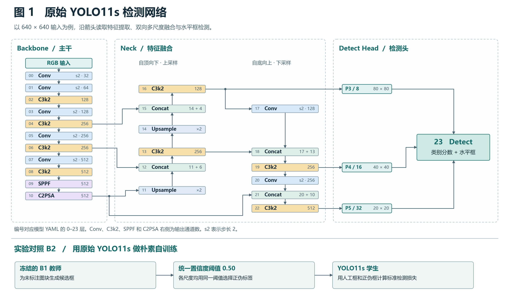
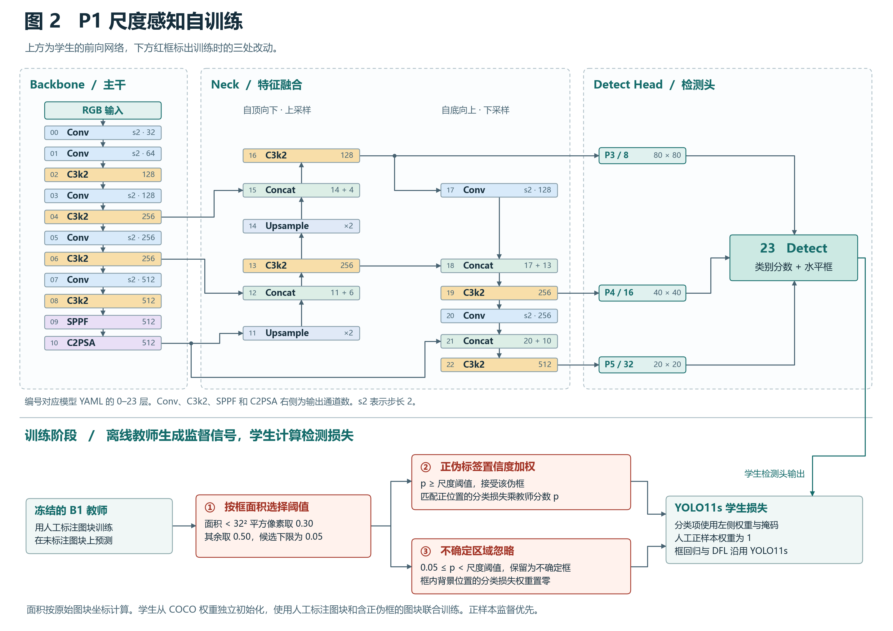

# YOLO11s 与 P1 方法图

## 图 1　YOLO11s 原始检测网络

[SVG 矢量图](yolo11s-architecture.svg) · [高清 PNG](yolo11s-architecture.png)

上半图按 Ultralytics 模型配置的编号绘制。第 4、6、10 层向融合网络提供特征，第 16、19、22 层分别以步长 8、16、32 将特征送入第 23 层 Detect。图中把 YAML 的 `head` 段拆成特征融合和最终检测头，便于辨认跨层连接。下半图单列本项目实际比较的 B2 训练方式。网络结构依据 [Ultralytics 官方 YOLO11 配置](https://github.com/ultralytics/ultralytics/blob/main/ultralytics/cfg/models/11/yolo11.yaml)。

## 图 2　P1 在训练流程中的改动

[SVG 矢量图](p1-training.svg) · [高清 PNG](p1-training.png)

B2 和 P1 共用同一固定教师。B2 用 0.50 统一选择正伪标签，P1 在教师候选转为学生监督信号时引入①，在学生计算分类损失时引入②和③。图中 `p` 表示教师给该候选框的置信度。

| 图中位置 | 实现 |
|---|---|
| ① 尺度分层 | 以原始图块上的框面积分组。小于 1024 平方像素的框取 0.30，其余取 0.50。达到阈值即接受。[筛选逻辑](../../../src/regionssod/pseudo/scale.py) · [阈值配置](../../../configs/pseudo_p1_10.yaml) |
| ② 正位置加权 | 对分配到正伪框的预测位置，分类损失乘以前景置信度 `p`。人工正样本权重为 1。分母沿用原任务对齐分配的目标分数之和。[分类权重](../../../src/regionssod/training/p1.py) |
| ③ 不确定区域忽略 | 对已入训的图块，把置信度介于 0.05（含）与正阈值（不含）之间的候选作为不确定区域。背景预测位置的中心落入该区域时，各类别的负分类项权重置零。已分配的正位置优先。[分类掩码](../../../src/regionssod/training/p1.py) |

## 项目已引用的相关论文

编号沿用稿件的[参考文献](../references.md)。下表列出与两张图直接相关的研究。项目的实测性能对照为 B2 与 P1，两学生种子的 100 轮结果见[主实验](../p1_b2_seed1_full100_results.md)。

| 论文 | 与本图的关系 |
|---|---|
| **[12] Zhang 等，S³OD: Size-unbiased semi-supervised object detection in aerial images**，ISPRS Journal of Photogrammetry and Remote Sensing，2025，221，179–192 | 最接近①和③。S³OD 已提出尺度自适应阈值与教师引导的负学习。P1 在区域局部标注协议下使用固定分层阈值，并屏蔽不确定框内的背景分类项。[期刊原文](https://doi.org/10.1016/j.isprsjprs.2025.01.037) · [项目逐项对照](../s3od_comparison.md) |
| **[6] Xu 等，End-to-End Semi-Supervised Object Detection with Soft Teacher**，ICCV 2021 | 对应②的教师可靠性加权思路。原文第 3.2 节用教师背景分数给负候选加权。P1 使用已接受伪框的前景分数给匹配正位置的分类损失加权。[论文全文，第 3.2 节](https://arxiv.org/html/2106.09018) |
| **[4] Sohn 等，A Simple Semi-Supervised Learning Framework for Object Detection（STAC）**，arXiv，2020 | 对应两张图中的离线自训练流程。先用标注数据训练教师，再以高置信伪框监督学生。项目的 B2 将这一思路落实为 YOLO11s 加统一 0.50 阈值。[作者论文](https://arxiv.org/abs/2005.04757) |
| **[11] Suri 等，SparseDet: Improving Sparsely Annotated Object Detection with Pseudo-positive Mining**，ICCV 2023 | 对应③所处理的漏标背景问题。SparseDet 挖掘伪正候选，P1 用教师的不确定框界定需要屏蔽的负分类项。[会议论文](https://openaccess.thecvf.com/content/ICCV2023/papers/Suri_SparseDet_Improving_Sparsely_Annotated_Object_Detection_with_Pseudo-positive_Mining_ICCV_2023_paper.pdf) |
