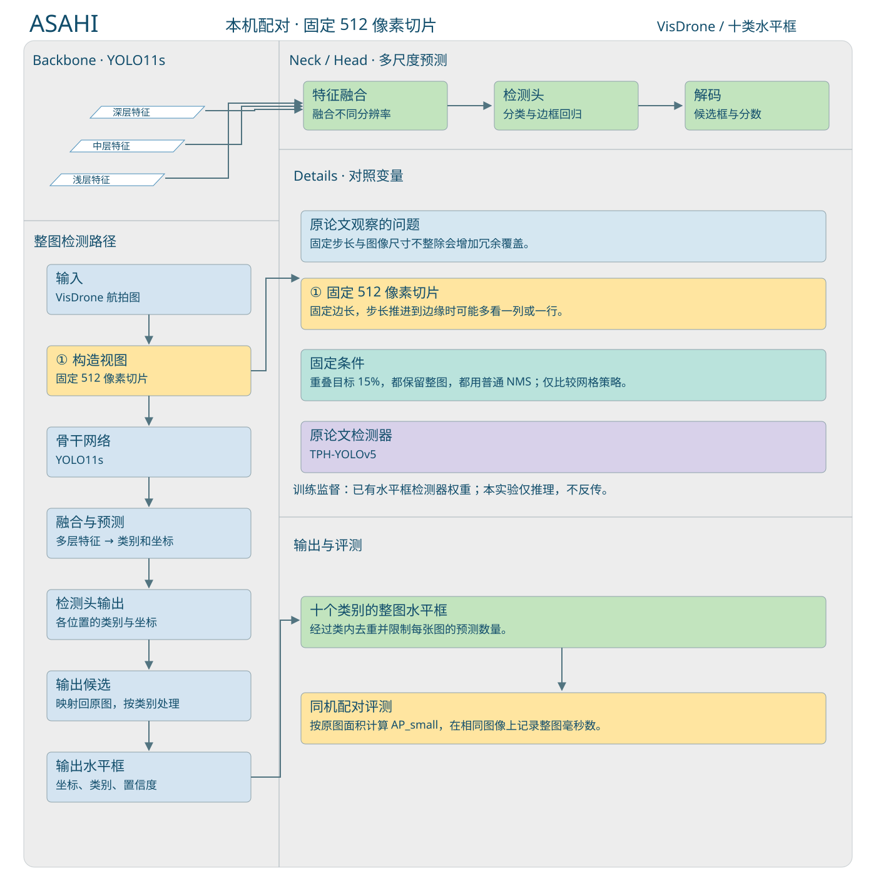
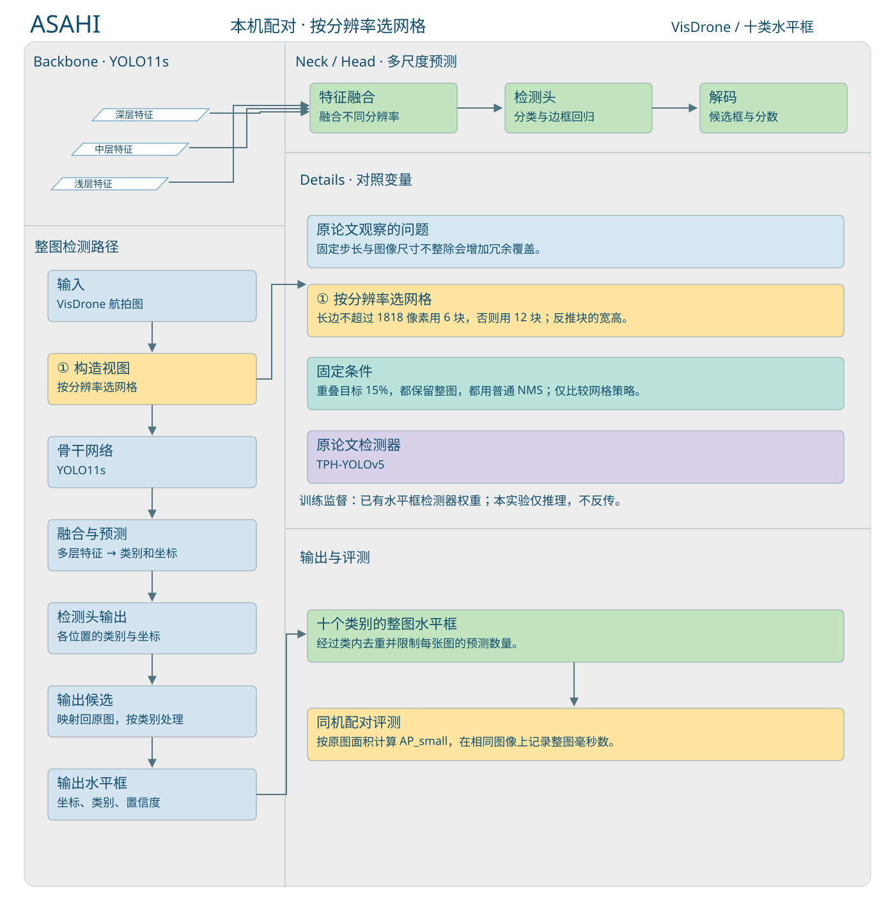

# ASAHI：固定块大小，还是固定网格数量？

| 固定 512 像素切片 | ASAHI 按图像尺寸选择 6 或 12 块 |
|---|---|
|  |  |

**权重评测（按期刊论文独立实现的推理消融）**。郝川艳等，《自适应切片辅助增强的小物体目标检测》，《中国图象图形学报》30(7)，2025，[正式版本](https://doi.org/10.11834/jig.240450)。表 2 用 TPH-YOLOv5 比较固定 512 与自适应切片，在 VisDrone test 报告小目标 **AP50** 29.8 → 33.8、3.69 → 4.88 图/s。表 4 另拆分整图、后处理与裁片微调。本机不把这些一起打开，而是问：**其他条件相同，单改切片几何能不能提高 AP_small？**

按算法 3 / 式（1–2），图长边 ≤1818 选 3×2，否则 4×3，纵图转置。按轴反推块大小、目标重叠 15%；取整后两端对齐原图。对照用固定 512 块，遇到边缘则平移。两臂均保留一次整图前向，单视图推理 512×512、conf 0.001、局部 NMS 0.7、跨视图类内 NMS 0.5；不使用论文的 Cluster-DIoU-NMS，也不重新训练。未核实作者专用代码或权重。[实现](../../../reproduce/asahi/grid.py) · [双权重及本机评测协议](../README.md#本轮配对协议)。

| 权重 | 小目标 AP 固定→自适应 | 差值（点） | 小目标 AP50 | 总体 AP | ms/原图 |
|---|---:|---:|---:|---:|---:|
| 0 | 18.854 → 20.738 | +1.883 | 35.939 → 39.203 | 27.285 → 28.750 | 116.20 → 108.44 |
| 1 | 18.838 → 20.429 | +1.592 | 36.103 → 38.937 | 27.476 → 28.510 | 95.26 → 104.05 |

两份权重的小目标 AP 和总体 AP 均提高；每图平均块数从 6.312 降到 6.208，但测速一快一慢，**不支持稳定提速**。网格还改变了目标在切片内的像素尺寸，不能只凭块数断言精度来自减少冗余。逐图分块数（不含整图）、毫秒和权重 SHA-256 在 `reproduce/asahi/local/val-548.json`。Zotero 正式中文 PDF `P9B2HVMD`。只按这一篇计数，不重复计算相似英文稿。

逐图对齐后，**529/548 张图的切片数与固定组相同，只有 19 张减少**。因此「同样看几块时，框边界和目标放大倍数是否更合适」比「少跑几次」更值得做后续消融。

```powershell
reproduce/sahi/local/env/Scripts/python.exe -m scripts.reproduce.asahi.evaluate
```
