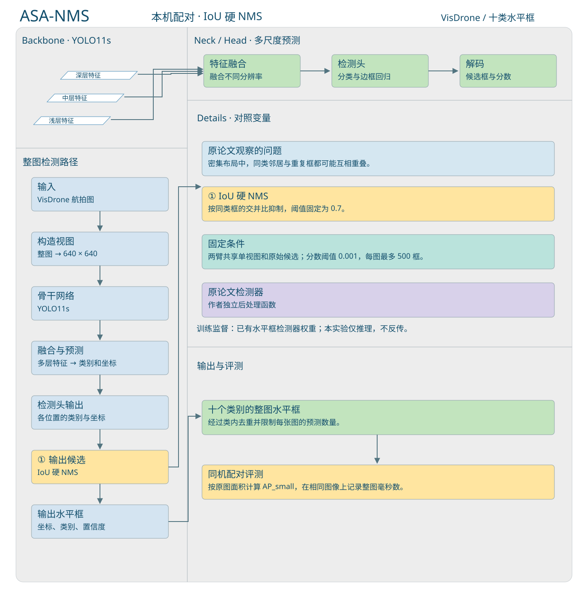
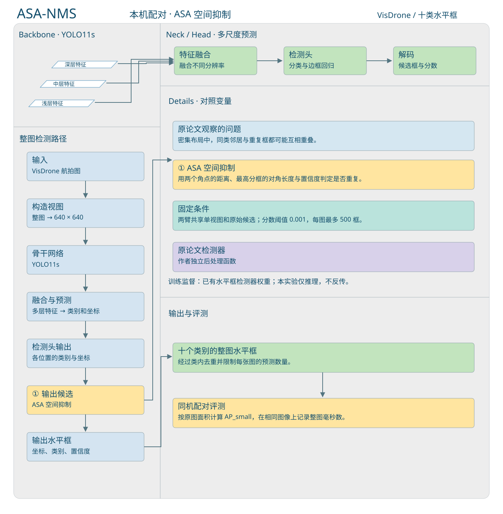

# ASA-NMS：用角点距离与分数区分重复框和相邻目标

| 本机 IoU 硬 NMS | ASA 空间自适应抑制 |
|---|---|
|  |  |

*Adaptive spatial-aware non-maximum suppression for dense object detection*，[Neurocomputing 第 670 卷，2026](https://doi.org/10.1016/j.neucom.2025.132541)。[作者仓库](../../../reproduce/asanms/upstream/) `db26658590af1ccef2ef09c5150ba350a0f938c4` 只有抑制函数与标题说明，不含检测器、训练、权重和数据。出版社 DOI 已归档在 Zotero `762AZYRR`；未取得开放 PDF，原文表号和精度值不作推断。它是针对密集候选的思想来源，不能直接声称是 VisDrone 的作者实验。

**推理机制迁移**：同一份 YOLO11s 权重、相同 640 输入、相同检测头输出，阈值 0.001。硬 NMS 用类内 IoU 0.7；ASA-NMS 用两角点欧氏距离之和、最高分框对角长度与候选分数做抑制，不改保留框的坐标和分数。沿用作者 `gamma=alpha=0.1`，未用 val 寻优。为避免 Python 逐框同步，方法臂用等价的 Numba CPU 循环；保留全局分数前 500 而非按类别遍历顺序提前截断。已与作者函数在无截断样本上按类核对保留索引。测速包括数据搬运，只代表本机实现。[评测口径](../README.md#本轮配对协议)。

```powershell
git submodule update --init reproduce/asanms/upstream
reproduce/sahi/local/env/Scripts/python.exe -m pytest tests/reproduce/asanms
reproduce/sahi/local/env/Scripts/python.exe -m scripts.reproduce.asanms.evaluate
```

**本机结论：相对硬 NMS，两份权重的小目标 AP 均略降。** VisDrone val 全部 548 张原图，AP 以点计；每行两臂共用同一份权重。

| YOLO11s 权重 | 总体 AP（硬 NMS → ASA） | 小目标 AP（硬 NMS → ASA） | 小目标 AP 差 | 平均 ms/原图（硬 NMS → ASA） |
|---|---:|---:|---:|---:|
| 0 | 16.093 → 16.051 | 6.784 → 6.768 | −0.016 | 17.06 → 15.83 |
| 1 | 16.392 → 16.338 | 6.903 → 6.847 | −0.057 | 15.56 → 15.32 |

本次两组计时均略短，但每个权重每臂只有一轮计时，不能据此断言稳定提速。结果只检验默认抑制规则在本机检测器上的迁移，不是否定作者在其他检测器上的结果。逐臂结果与权重摘要见 `reproduce/asanms/local/val-548.json`。
