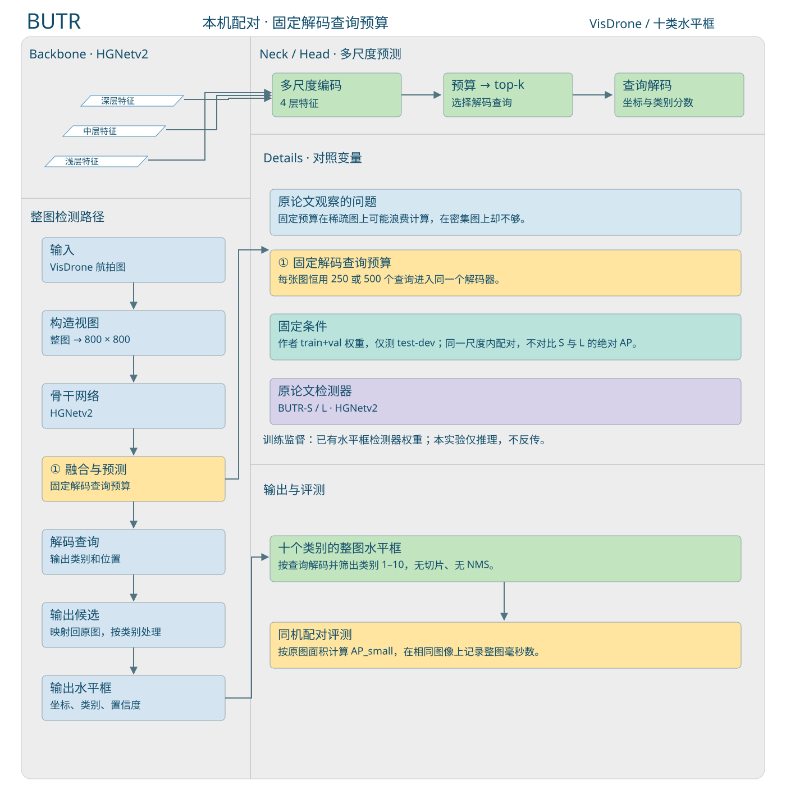

# BUTR：每张图的解码查询预算能否减少？

| 固定查询对照 | BUTR 动态查询 |
|---|---|
|  |  |

[论文](https://arxiv.org/abs/2610.33430) *Dynamic Query as Budgeting for Tiny Object Detection*（2026）。[作者实现](../../../reproduce/butr/upstream/) `1b74f1fe4a243b08da53cb928c315cc85a2c1ead` 提供训练、评测以及 VisDrone S/L 权重，不是只发评测器。原文表 1 是 Dome-DETR-L 推理消融，表 4 是 VisDrone 整模型比较；作者报告 BUTR-S / L 的 AP 为 26.8 / 29.8。这些不是本机对照。Zotero 预印本 PDF `FCUX2T2K`。

**权重评测设计**：同一份作者权重，整图 RGB 按作者实现拉伸至 800×800。固定 250、动态 250～500 整数、固定 500；`budget_map=linear` 不是选择离散的两档。固定臂不做置信度求和，其他 top-k 选取、同一解码器和后处理不变。该消融只检验已训练模型的推理预算，不是与独立训练的 Dome-DETR 比较。分别在 BUTR-S 和 L 中配对；两者是模型尺度不是训练种子。作者使用 train+val，**只在 1610 张有标注 test-dev 上判断泛化**。本机忽略区和十类 COCO 指标遵循[项目协议](../README.md#本轮配对协议)，不混用作者评测的绝对 AP。

从[作者发布页](https://github.com/zhangyi-magic/BUTR/releases/tag/checkpoints)将 `butr_s_visdrone.pth` 和 `butr_l_visdrone.pth` 放在 `reproduce/butr/local/`。已对照发布资产 SHA-256：S `e7300227f028890700dbcf5cc05bbad2247f9745986e3c418a80ec3a33a3de7b`；L `75a697f3e4f3a7f12d93518520080e47e3724432414df8f2424a8cb8ea4e2830`。

```powershell
git submodule update --init reproduce/butr/upstream
reproduce/sahi/local/env/Scripts/python.exe -m scripts.reproduce.butr.evaluate --limit 2
reproduce/sahi/local/env/Scripts/python.exe -m scripts.reproduce.butr.evaluate
```

**已验证的作用是节约查询，不是稳定提速。** 完整 test-dev 上，把固定 500 改成动态预算，S/L 平均各少用 96.06 / 79.62 个查询（−19.21% / −15.92%）。对应总体 AP 差 −0.036 / −0.034 点，小目标 AP 差 −0.039 / −0.039 点；整图均值反而多花 1.16 / 1.26 ms。精度差很小不等于通过了统计等效性检验。查询计算只是整图管线的一部分，本实验没有分段计时来判定瓶颈。

两图运行只是工程烟测；完整结果写入 `reproduce/butr/local/test-1610.json`，逐图保存实际解码查询数与整图耗时。

| 作者权重 | 预算 | 平均查询数 | 总体 AP | 小目标 AP | ms/原图 |
|---|---|---:|---:|---:|---:|
| S | 固定 250 | 250 | 26.664 | 16.946 | 62.09 |
| S | 动态 | 403.94 | 27.114 | 17.433 | 63.11 |
| S | 固定 500 | 500 | 27.150 | 17.472 | 61.95 |
| L | 固定 250 | 250 | 29.623 | 19.338 | 78.38 |
| L | 动态 | 420.38 | 30.049 | 19.742 | 74.41 |
| L | 固定 500 | 500 | 30.083 | 19.780 | 73.15 |

相对固定 250，小目标 AP 两次都升（+0.487 / +0.403），但动态臂使用了更多查询。这不能代替等查询预算对照，也不能宣称模型一定更快。
