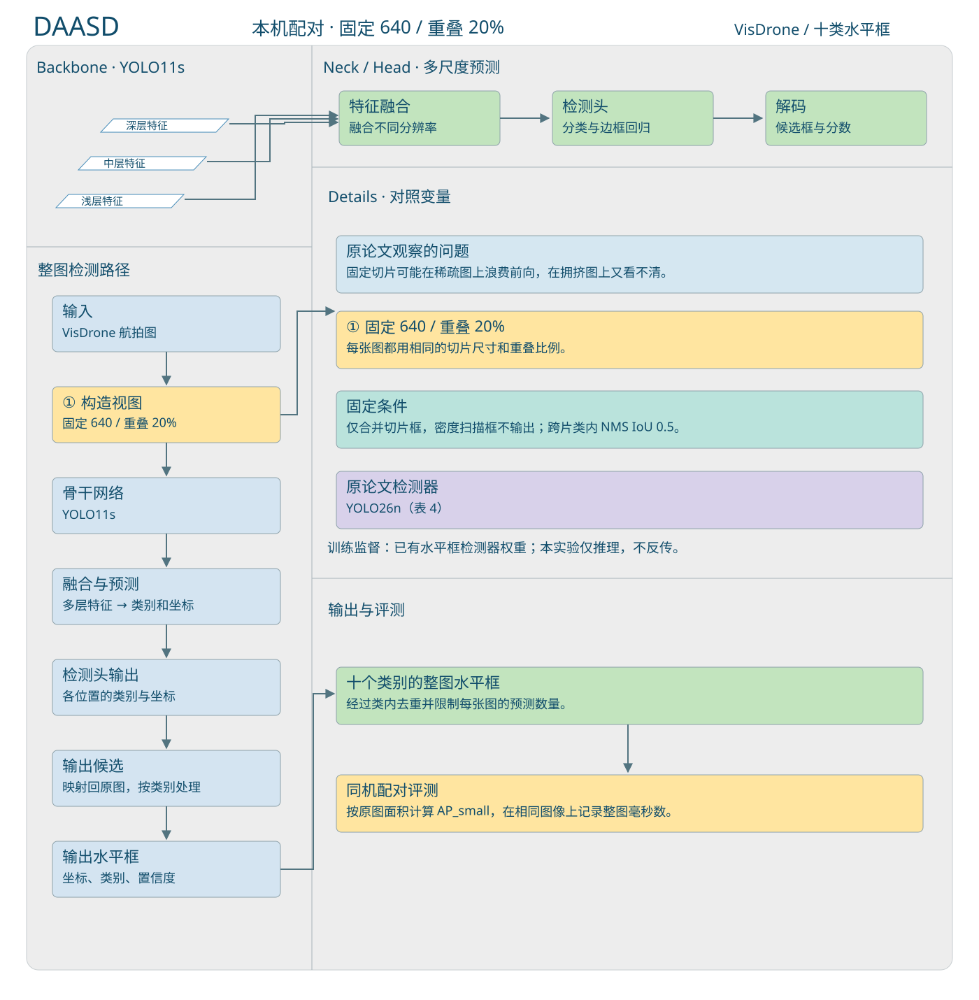
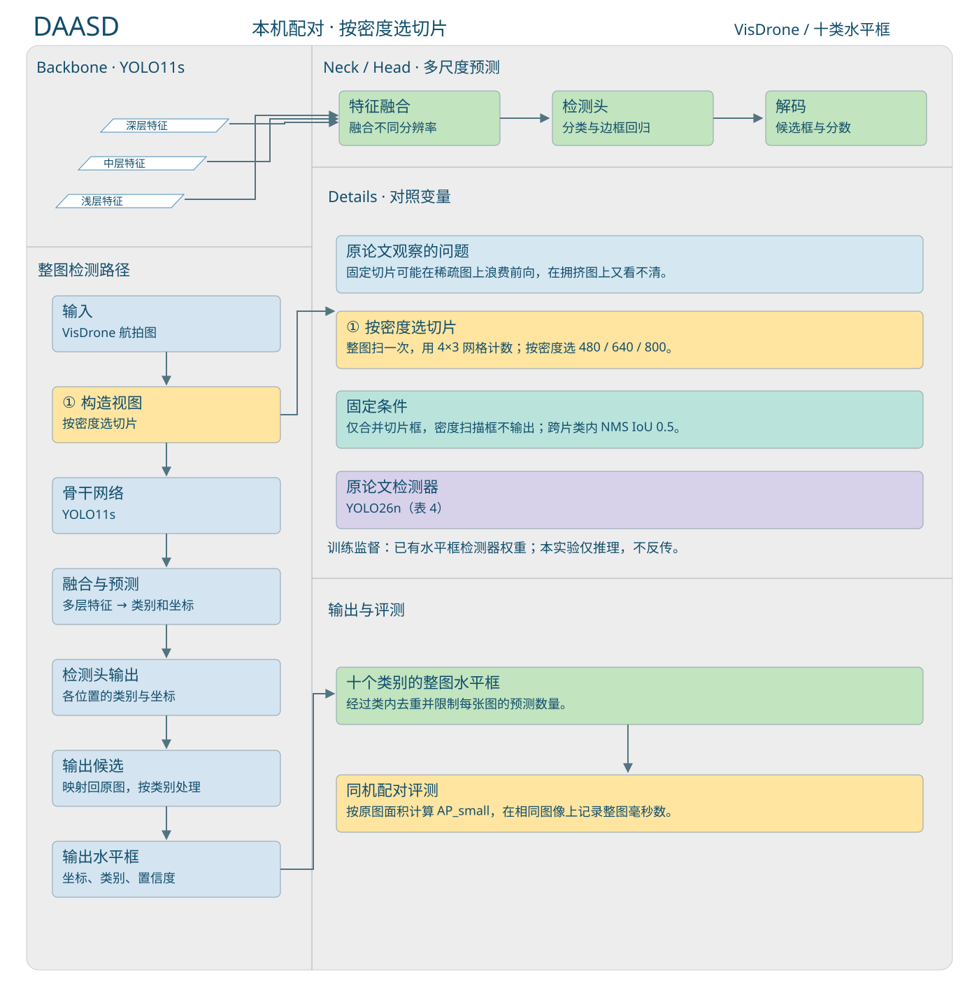

# DAASD：按图像密度选择切片尺寸

| 固定切片对照 | DAASD 自适应切片 |
|---|---|
|  |  |

**权重评测（按公开算法独立实现推理，不是独立训练）**。在两份 YOLO11s 权重、相同 548 张 VisDrone val 图上，自适应比固定切片提高小目标 AP，但平均每张原图更慢。只拿整图当基线会大幅高估「按密度选择」本身的效果。

| 权重 | 策略 | 小目标 AP | 总体 AP | AP50 | ms/原图 |
|---|---|---:|---:|---:|---:|
| 0 | 整图 | 6.784 | 16.093 | 27.242 | 13.21 |
| 0 | 固定 | 18.938 | 27.949 | 46.237 | 80.40 |
| 0 | 自适应 | 19.890 | 28.552 | 47.222 | 91.92 |
| 1 | 整图 | 6.904 | 16.392 | 27.650 | 13.20 |
| 1 | 固定 | 18.655 | 27.821 | 46.219 | 63.34 |
| 1 | 自适应 | 19.926 | 28.711 | 47.364 | 75.73 |

固定→自适应：小目标 AP **+0.953 / +1.272**，耗时 **+11.52 / +12.39 ms**。按各权重的扫描结果分组，再取固定臂中**同一批图**：低密度各 193 图，平均省 25.29 / 21.98 ms；高密度 120 / 112 图，多花 60.81 / 58.02 ms。这是推理工作量的转移，不是全数据集无代价提速。

[正式论文](https://doi.org/10.3390/drones10110803) *Density-Aware Adaptive Slicing Detection for Dense Small Objects in UAV Urban Low-Altitude Imagery*（Drones，2026）。原文表 4 的 YOLO26n 在 547 张 val 上，固定与自适应 mAP50 为 37.66 / 37.51；表 5 说明低密度组提速、高密度组变慢。未核实作者专用实现；不复现 P2 检测头、训练或该 AP 绝对值。

[实现](../../../reproduce/daasd/slicing.py)：整图以 conf 0.1 扫描，中心计入 4×3 网格，整图框不参加合并。最大计数 >30 或均值 >15 用 480/30%；否则最大 >15 或均值 >8 用 640/20%；其余 800/10%。固定组 640/20%。所有输入统一缩放补边至 640；单视图 conf 0.001、YOLO11s 类内 NMS 0.7，跨片 NMS 0.5。边缘窗口平移贴齐，batch 1，全图像素提前解码，GPU 同步后计时。[权重、环境与评测](../README.md#本轮配对协议)。完整记录 `reproduce/daasd/local/val-548.json`；逐图数组依次为密度档、切片数、毫秒。Zotero PDF `C2GT3PB4`。

```powershell
reproduce/sahi/local/env/Scripts/python.exe -m scripts.reproduce.daasd.evaluate
```
