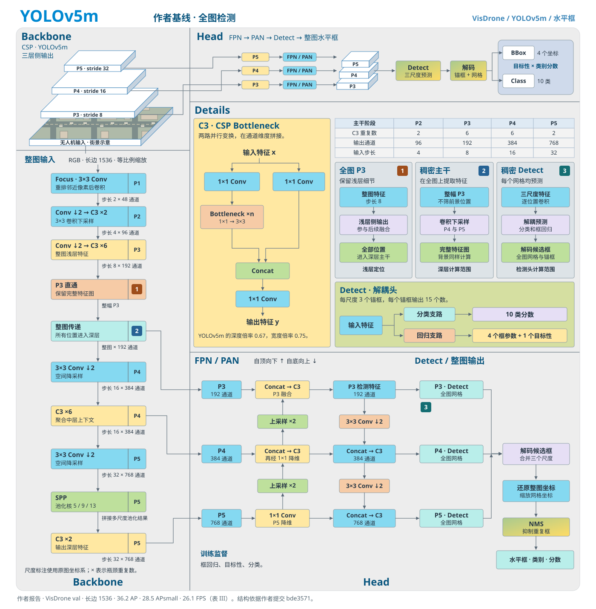
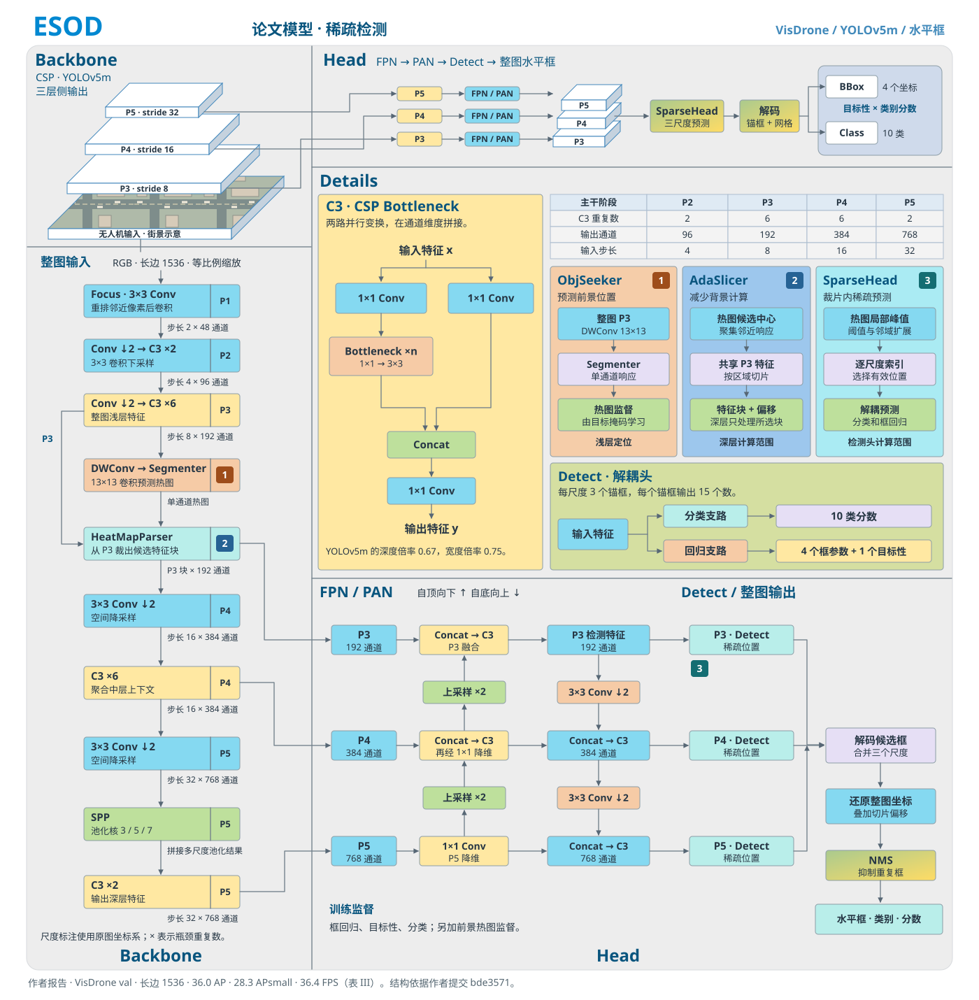

# ESOD · 无人机航拍小目标检测

| 作者基线 · YOLOv5m | 论文方法 · ESOD-YOLOv5m |
|---|---|
| [](yolov5m-baseline-architecture.svg) | [](esod-architecture.svg) |

点击 SVG 可放大。顶部从整图概览走到水平框输出。沿左侧主干向下读，P3、P4、P5 三条侧线接入下方的双向特征金字塔，再汇入检测头。①②③ 把计算位置和中间的算子详图对应起来。

## 这篇论文解决什么问题

高分辨率有利于检测远处的小车和行人，但航拍图里大量区域是背景。作者在 VisDrone 上把图像均分为 8×8 块，超过 70% 的块没有目标。ESOD 先在整图上计算浅层特征，再把深层计算集中到可能有目标的区域。研究对象是全监督水平框检测，适合作为“小目标精度与整图推理效率”的直接对照。[原文 §IV-A、表 III–IV](https://arxiv.org/html/2407.16424v2)

| 位置 | 作者基线 | ESOD 的改动及依据 |
|---|---|---|
| ① 浅层定位 | P3 的所有位置都进入后续计算 | ObjSeeker 从 P3 预测前景热图。训练增加热图监督，验证时从图像预测。热图监督策略见表 V。 |
| ② 深层主干 | 在整幅特征图上计算 P4、P5 | AdaSlicer 按前景响应从共享 P3 裁出特征块，记录偏移，后续特征提取与融合在块内进行。切片尺寸消融见表 VII。 |
| ③ 检测头 | 三个尺度逐网格预测水平框 | SparseHead 依据热图选择预测位置，再把框还原到整图坐标。表 IV 分别考察分辨率、切片和稀疏头。 |

## 本机配对实验

普通 YOLOv5m 使用作者的 `vanilla` 配置，ESOD-YOLOv5m 使用作者的 `esod` 配置和推理稀疏头。两组都从同一份 YOLOv5m v5.0 COCO 权重开始，按作者规则迁移形状匹配的层。比较量为相同种子下 **ESOD 减普通 YOLOv5m**。AP 越高越好，平均毫秒数越低越好。

初筛从官方 train 用抽样种子 42 无放回抽取 32 张训练图和另外 16 张内部验证图。两组共用长边 768、batch 4、30 epochs 和作者的 VisDrone 超参数；训练种子分别为 1、2。768 满足作者等分切块的尺寸约束。ESOD 采用作者脚本的高斯热图监督（无 SAM）。固定取第 30 轮 `last.pt` 的 EMA，在另行保留的官方 val 全部 548 张上，以 FP32、batch 1、预测热图和同一个 COCOeval 入口评测。训练期间打印的 16 图指标仅用于观察收敛。

**独立训练复现 · 小样本初筛**　两个种子下，ESOD 的小目标 AP 分别下降 **0.285、0.336 点**，总体 AP 也都下降。当前结果不支持 ESOD 在这套小样本条件下提高小目标检测精度。32 张训练图合计 2,016 个有效框，两组总体 AP 均低于 1.5 点。全量训练下的精度与速度收益仍待配对验证。

| 训练种子 | 模型 | AP | AP50 | 小目标 AP | 前向 ms/图 | 流水线 ms/图 |
|---:|---|---:|---:|---:|---:|---:|
| 1 | YOLOv5m | 1.472 | 4.420 | 0.616 | 7.62 | 41.04 |
| 1 | ESOD | 0.758 | 2.484 | 0.331 | 18.62 | 37.82 |
| 1 | ESOD − YOLOv5m | −0.714 | −1.935 | −0.285 | +10.99 | −3.22 |
| 2 | YOLOv5m | 1.492 | 4.392 | 0.757 | 10.77 | 42.97 |
| 2 | ESOD | 0.977 | 3.063 | 0.421 | 16.75 | 34.10 |
| 2 | ESOD − YOLOv5m | −0.515 | −1.329 | −0.336 | +5.97 | −8.87 |

AP 按 0–100 报告，差值用舍入前的数值计算。四组评测使用相同的 38,759 个真值框。权重、训练日志与逐图结果在 `reproduce/esod/local/pair32-768/{vanilla,esod}-s{1,2}/`。`official-val/summary.json` 记录各自的权重 SHA-256、EMA 分支、轮次及计时汇总。

**整图耗时复测**　四份权重再按首轮的逆序各推理 548 张，每组单独启动进程、热身 10 次，沿用同一个 `predict` 入口，各自输出的检测框总数与首轮一致。下表为第二轮的平均毫秒/图。两个种子、两轮计时中，ESOD 的前向均较慢（多 5.97–10.99 ms/图），含预处理、NMS 和框回传的流水线均较快（少 3.22–11.42 ms/图）。计时从已解码的图像开始。此结果适用于本机 RTX 4070 Ti、长边 768、当前权重及阈值。

| 训练种子 | YOLOv5m 前向 | ESOD 前向 | YOLOv5m 流水线 | ESOD 流水线 |
|---:|---:|---:|---:|---:|
| 1 | 11.24 | 17.87 | 47.91 | 36.48 |
| 2 | 12.16 | 18.75 | 46.02 | 36.23 |

## 公开权重重评与文献记录

同一份公开权重，把推理长边从 1536 提高到 1920，小目标 AP 从 **25.97 提高到 27.42（+1.46 点，按未舍入值计算）**，每档两次完整评测一致。该分辨率对照只用于说明同一模型在两种推理尺寸下的表现。

以下为 VisDrone-DET **val，548 张**。AP 按 0–100 报告。作者使用单张 NVIDIA V100、batch 1 报告 FPS。论文 `†` 表示输入宽高各扩大 1.25 倍。本机 1920 这一行只改变测试尺寸，公开权重内嵌的是 1536 配置；作者没有为下载文件标明独立的 `†` 训练记录。[原文 §IV-B–D、表 III](https://arxiv.org/html/2407.16424v2)

| 证据 | 模型及长边 | AP | AP50 | 小目标 AP | 前向 FPS |
|---|---|---:|---:|---:|---:|
| 文献报告 · 表 III | 作者 YOLOv5m，1536 | 36.2 | 60.1 | 28.5 | 26.1 |
| 文献报告 · 表 III | ESOD，1536 | 36.0 | 59.7 | 28.3 | 36.4 |
| 文献报告 · 表 III | ESOD `†`，1920 | 37.9 | 62.3 | 30.8 | 28.6 |
| 权重评测复现 · COCOeval | ESOD 稀疏头，1536，两轮 | 33.33 | 55.77 | 25.97 | 27.24 / 31.54 |
| 本机减同尺寸论文值 | ESOD，1536 | −2.67 | −3.93 | −2.33 | 硬件不同 |
| 权重评测复现 · COCOeval | ESOD 稀疏头，1920，两轮 | 34.33 | 57.22 | 27.42 | 27.29 / 24.59 |
| 本机减论文 `†` 行 | ESOD，1920，仅作参照 | −3.57 | −5.08 | −3.38 | 硬件不同 |
| 同权重模块对照 · COCOeval | ESOD 裁片 + 稠密头，1536，两轮 | 33.48 | 56.18 | 26.13 | 29.82 / 39.42 |

在论文的同尺寸对照中，ESOD 的 AP 和小目标 AP 各下降 0.2 点，速度由 26.1 升至 36.4 FPS。论文的 30.8 小目标 AP 出现在更高分辨率。本机同权重单独开启稀疏头后，小目标 AP 比裁片加稠密头低 0.16 点。

### 作者评测器交叉核对

直接调用固定提交的 `test.test`、`LoadImagesAndLabels` 和 `utils.metrics.ap_per_class`，保留预测热图、FP32、长边 1536 和矩形批次。两种评测都读到 548 张图、38,759 个真值框。作者内部评测器只汇报总体 AP 和 AP50，精度汇总与 COCOeval 分开执行。

| 检测头 | batch | 作者代码本机 AP | 作者代码本机 AP50 |
|---|---:|---:|---:|
| 稀疏 | 1 | 32.96 | 56.01 |
| 稠密，保留 ESOD 裁片 | 1 | 33.09 | 56.41 |
| 稠密，保留 ESOD 裁片，作者 README 的默认测试组合 | 8 | 33.09 | 56.40 |

这三次交叉核对均未达到论文 36.0 AP。仓库的 `--save-json` 入口引用 `./datasets/VisDrone/annotations/val.json`；固定提交缺少该文件。本机从原始标注重建 COCO 真值，无法核对它与作者评测文件的逐框一致性。仓库也没有表 III 每行与发布权重的一一对应清单。现有证据不足以把 AP 差距归因于某一项。[作者评测代码](../../../reproduce/esod/upstream/test.py) · [作者仓库中的权重复评反馈](https://github.com/alibaba/esod/issues/11)

### 整图推理耗时

同一张 RTX 4070 Ti、batch 1、FP32；每轮先用第一张图热身 10 次，再逐张同步 CUDA，对完整 548 图取算术平均。FPS 为 `1000 / 平均毫秒`。前向包含模型内部选块和解码。流水线从已解码、已处理忽略区的 BGR 图开始，计入缩放、补边、传入 GPU、前向、NMS 和框回传；磁盘读取、忽略区预处理和精度统计位于计时区间外。

| 模型与运行目录（各两轮） | 长边 | 平均前向 ms/图 | 平均流水线 ms/图 | 流水线 FPS |
|---|---:|---:|---:|---:|
| 作者基线计算图 `vanilla1/2` | 1536 | 17.67 / 17.57 | — | — |
| ESOD 稀疏头 `sparse1/2` | 1536 | 36.71 / 31.71 | 49.05 / 42.56 | 20.39 / 23.50 |
| ESOD 裁片 + 稠密头 `dense1/2` | 1536 | 33.54 / 25.36 | 47.01 / 35.57 | 21.27 / 28.12 |
| ESOD 稀疏头 `large1/2` | 1920 | 36.64 / 40.66 | 49.32 / 55.29 | 20.28 / 18.09 |

**仅代码可运行 · 基线工程测速**　作者下载目录提供 ESOD 的 YOLOv5m 和 YOLOv8m 权重。本次可获取的文件中缺少在 VisDrone 上训练好的 vanilla YOLOv5m。基线依照作者的 `vanilla/visdrone_yolov5m.yaml`、种子 0 随机初始化，使用静态稠密计算图测得 **56.61 / 56.91 前向 FPS**。权重影响预测、NMS 和 AP，所以基线只报前向耗时。两轮存在速度波动，现有数据只能判断这台设备与这套实现的表现。

## 复跑条件

| 项目 | 本次使用的版本或协议 |
|---|---|
| 论文 | Kai Liu 等，*ESOD: Efficient Small Object Detection on High-Resolution Images*，IEEE TIP 34 (2025), 183–195。DOI `10.1109/TIP.2024.3501853`，表号与数值核对 `arXiv:2407.16424v2`。 |
| 作者实现 | `alibaba/esod`，固定提交 `bde3571bd7db697e441eef0278cd425e888ea026`。仓库提供模型、训练、评测与数据转换脚本，图像和模型权重单独下载。 |
| 权重 | `esod_yolov5m.pt`，215,529,641 字节，SHA-256 `7adbe5e7fbfb968aaf7cea5dbf98ee0ed2bc5fc149c962167482a32492c29fae`。使用 checkpoint 的 `ema`，`epoch=46`，十类检测。 |
| 数据 | 官方 train 6,471 张、val 548 张。公开权重重评与配对模型的最终评测均读 `data/visdrone/images/val` 与 `original_annotations/val`。 |
| 输入和真值 | 仿作者数据准备，把类别 0、11 区域涂为 85，有忽略区的图像再做一次 JPEG 编解码。十类目标保留 `truncation < 2`，含重遮挡；推理中的前景热图来自网络。忽略区涂灰使用验证标注，此预处理与实际部署时直接读图有区别。 |
| 检测与指标 | 保持宽高比，初筛长边 768，公开权重重评长边 1536 或 1920，按 32 补边。置信度 0.001，多标签 NMS IoU 0.6，每图最多 500 框。COCOeval `bbox`、IoU 0.50–0.95、默认 `maxDets=100`，小目标按原图框面积统计。 |
| 环境 | Windows、RTX 4070 Ti、驱动 591.86、Python 3.12.4、Torch 2.10.0+cu128、torchvision 0.25.0+cu128、NumPy 2.2.6、OpenCV 4.12.0、pycocotools 2.0.11。 |

来源：[期刊 DOI](https://doi.org/10.1109/TIP.2024.3501853) · [作者代码快照](https://github.com/alibaba/esod/tree/bde3571bd7db697e441eef0278cd425e888ea026) · [公开权重目录](https://drive.google.com/drive/folders/1jrrtG34q6gqdGMx7SflNK1uM6iiVKpin) · [本次权重](https://drive.google.com/file/d/1vDHHCw33vqYFpJvcNJ32G4IUQIrKvimX/view) · [VisDrone 数据与评测](https://github.com/VisDrone/VisDrone-Dataset)

在仓库根目录运行。首次准备时，把上方权重存为 `reproduce/esod/local/esod_yolov5m.pt`。以下环境复用本机已有的 `yolo` 数值计算依赖。

```powershell
git submodule update --init reproduce/esod/upstream
$localRun = 'reproduce/esod/local'
$py = "$localRun/env/Scripts/python.exe"
& "$env:USERPROFILE/.conda/envs/yolo/python.exe" -m venv --system-site-packages "$localRun/env"
& $py -m pip install setuptools==80.9.0 scikit-image==0.26.0 timm==1.0.31 einops==0.8.2
```

```powershell
# 四种条件依次各跑两轮，耗时沿用单进程、单 GPU 口径。
foreach ($round in 1,2) {
    & $py scripts/reproduce/esod/evaluate_visdrone.py --head sparse --output "$localRun/sparse$round"
    & $py scripts/reproduce/esod/evaluate_visdrone.py --head dense --output "$localRun/dense$round"
    & $py scripts/reproduce/esod/evaluate_visdrone.py --head vanilla-timing --output "$localRun/vanilla$round"
    & $py scripts/reproduce/esod/evaluate_visdrone.py --head sparse --long-edge 1920 --output "$localRun/large$round"
}
& $py -m scripts.reproduce.esod.author_val --head sparse --batch 1
& $py -m scripts.reproduce.esod.author_val --head dense --batch 1
& $py -m scripts.reproduce.esod.author_val --head dense --batch 8
```

每轮目录保存 `summary.json` 和逐图 `durations_ms.json`，有检测结果时另存 `predictions.json`。作者评测器的汇总在 `reproduce/esod/local/author-*-b*.json`，其输入副本在 `data/esod/val`。重画两张 SVG 只需标准库，运行 `python reproduce/esod/figures/draw_pair.py`。

### 复跑本机配对实验

将 [作者指定的 YOLOv5m v5.0 权重](https://github.com/ultralytics/yolov5/releases/download/v5.0/yolov5m.pt) 保存为 `reproduce/esod/local/yolov5m-v5.0.pt`。入口会校验 SHA-256 `317d74254b2958ff33b3c42f1a0fd06ad5f2fa613a0e3e23bdf835a9579a99a8`，并在临时作者源码中适配种子、Windows 热图路径、worker 和整数网格索引。每次训练使用新的输出目录。

```powershell
& $py -m scripts.reproduce.esod.prepare_pair
$pair = "$localRun/pair32-768"
foreach ($seed in 1,2) {
    foreach ($arm in 'vanilla','esod') {
        $run = "$pair/$arm-s$seed"
        & $py -m scripts.reproduce.esod.train_visdrone --arm $arm --seed $seed --data data/esod/pair32/visdrone.yaml --output $run --long-edge 768 --batch 4 --epochs 30
        if ($LASTEXITCODE -ne 0) { throw "训练中断 $run" }
    }
}
foreach ($seed in 1,2) {
    foreach ($arm in 'vanilla','esod') {
        $run = "$pair/$arm-s$seed"
        $weights = "$run/weights/last.pt"
        $digest = (Get-FileHash -Algorithm SHA256 -LiteralPath $weights).Hash
        $head = if ($arm -eq 'esod') { 'sparse' } else { 'vanilla' }
        & $py -m scripts.reproduce.esod.evaluate_visdrone --head $head --long-edge 768 --weights $weights --sha256 $digest --output "$run/official-val"
        if ($LASTEXITCODE -ne 0) { throw "评测中断 $run" }
    }
}
```

全量数据已经准备到 `data/esod/pair-full/visdrone.yaml`，可用 `& $py -m scripts.reproduce.esod.prepare_pair --full` 重新核验。训练集 6,471 张、343,200 框，验证集 548 张、38,759 框。生成训练标签时合并 4 条完全重复框并跳过 1 条零面积框，两组使用同一份标签。全量训练由用户启动，沿用上述配对命令并切换到全量 YAML、独立输出目录、相同评测长边。作者大训练参数为长边 1536、batch 8、50 epochs。[作者训练入口](../../../reproduce/esod/upstream/scripts/train.sh)
