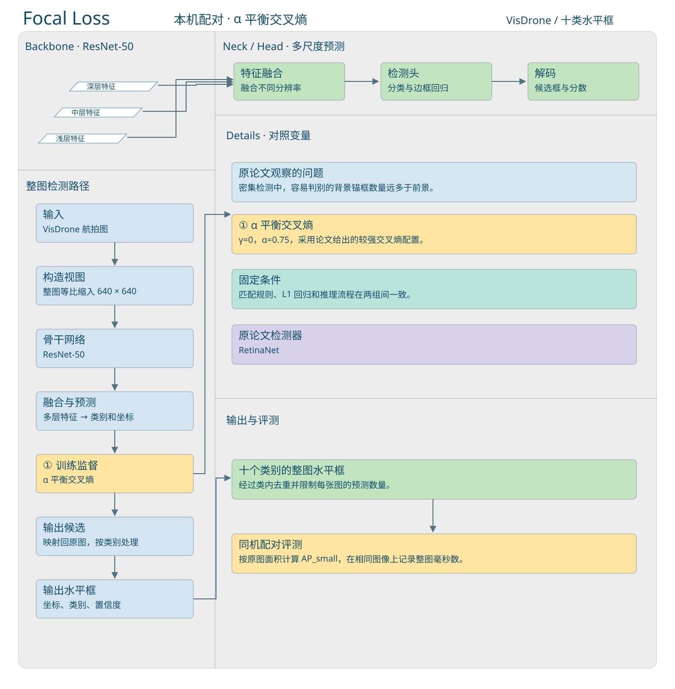
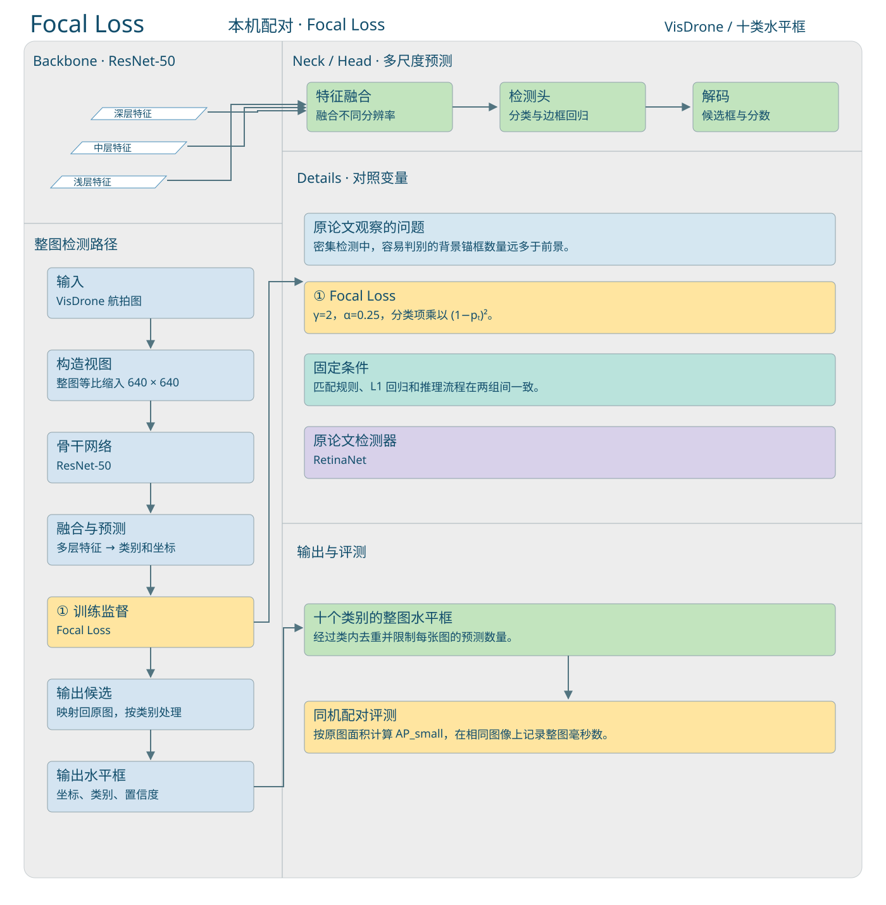

# Focal Loss 的难易样本加权

| 论文基线 · α 平衡交叉熵 | 论文方法 · Focal Loss |
|---|---|
|  |  |

一张航拍图里有很多一眼就能认出的背景位置。普通分类损失把这些位置的小误差逐一相加，容易盖过前景的学习信号。Focal Loss 让已经分对的简单位置少贡献一点损失，把更多训练权重留给难判断的位置。推理时仍然只跑一次原检测器。

**独立训练复现（小样本）。** 两个种子各完成了交叉熵和 Focal Loss 的 30 轮训练；四次训练损失均为有限值。小目标 AP 两次下降。两种配置在这 64 张图上训练后的小目标 AP 都接近零，这组数据对充分训练后的差异几乎没有分辨力。

| 种子 | AP_small 基线 → 方法 | 差值（点） | 全类 AP 基线 → 方法 | 整图 ms 基线 → 方法 |
|---|---:|---:|---:|---:|
| 0 | 0.01014 → 0.00369 | −0.00645 | 0.3533 → 0.1102 | 46.82 → 47.62 |
| 1 | 0.01366 → 0.00785 | −0.00581 | 0.3642 → 0.0803 | 47.81 → 50.26 |

**文献报告。** Lin 等，*Focal Loss for Dense Object Detection*，ICCV 2017，arXiv 1708.02002。表 1b 报告 RetinaNet 的 COCO minival AP：最优平衡交叉熵 γ=0、α=0.75 得 31.1，Focal Loss γ=2、α=0.25 得 34.0。作者 Detectron 含 RetinaNet 训练和评测、COCO 模型库；本机采用兼容 Windows 的 MMDetection RetinaNet-R50-FPN 实现。原表的变化包括聚焦指数和类别平衡系数。[论文](https://doi.org/10.1109/ICCV.2017.324) · [作者 Detectron](https://github.com/facebookresearch/Detectron/tree/04155a01a6ea68f22ac27c79a822066457941ece) · [本机 RetinaNet 配置来源](https://github.com/HZAI-ZJNU/RemDet/tree/8cf2667e9ff80122e89436a0ebc6558ff1cfdb93/config_remdet/retinanet)

**独立训练协议。** 固定 64 张训练图、完整 val 548 张。两臂共享 ImageNet 初始化的 ResNet-50、FPN、分类头和框回归头结构，以相同种子初始化新层。训练、测试均等比缩入 640×640，训练随机翻转；batch 4、SGD 学习率 0.0025、预热 16 步，第 22、27 轮降学习率，梯度范数上限 10。每个种子各臂固定训练 30 轮，评最后一轮。推理置信度 0.001、NMS IoU 0.5，每图至多 300 框。本机环境与[RemDet](../remdet/README.md)一致。[公共说明](../README.md#本轮配对协议)

**工程试跑。** 初次试图固定 α=0.25、只切 γ，未裁剪的交叉熵基线第 2 轮出现非有限损失，已中止。正式结果改用表 1b 的强基线，两臂统一梯度裁剪，试跑不计入结果。

```powershell
$python = 'reproduce/remdet/local/env/Scripts/python.exe'
New-Item -ItemType Directory -Force reproduce/focal/local | Out-Null
curl.exe -fL https://download.pytorch.org/models/resnet50-0676ba61.pth -o reproduce/focal/local/resnet50-0676ba61.pth
foreach ($seed in 0,1) { foreach ($arm in 'baseline','method') { & $python -m scripts.reproduce.focal.pair --seed $seed --arm $arm } }
```

共享初始权重 SHA-256 为 `0676ba61b6795bbe1773cffd859882e5e297624d384b6993f7c9e683e722fb8a`。训练日志、最后权重和 `val.json` 位于 `reproduce/focal/local/table1b/`；Zotero 对应子分类挂有 PDF `VY7DKZ6Q`。
