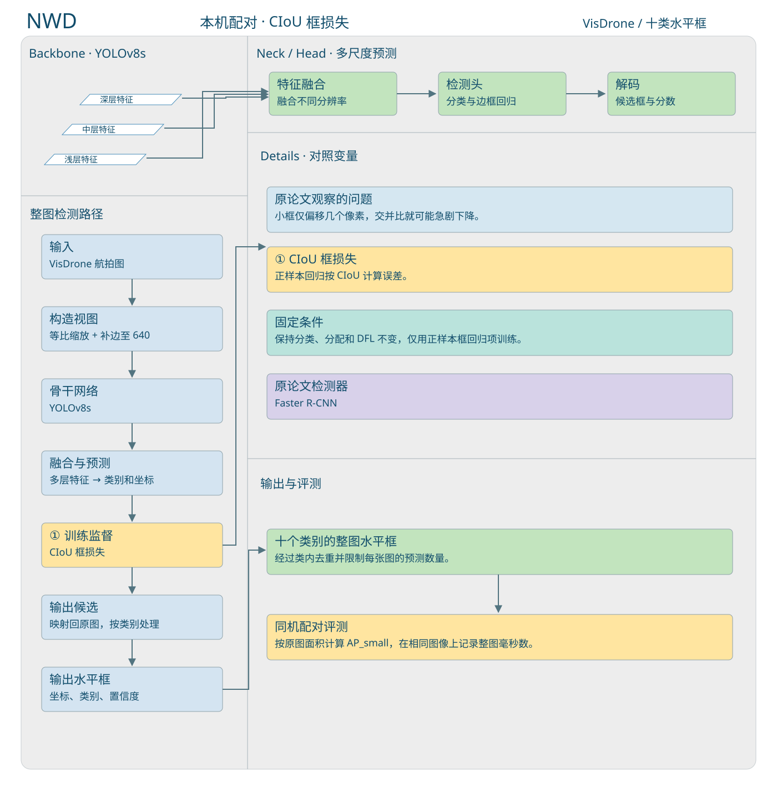
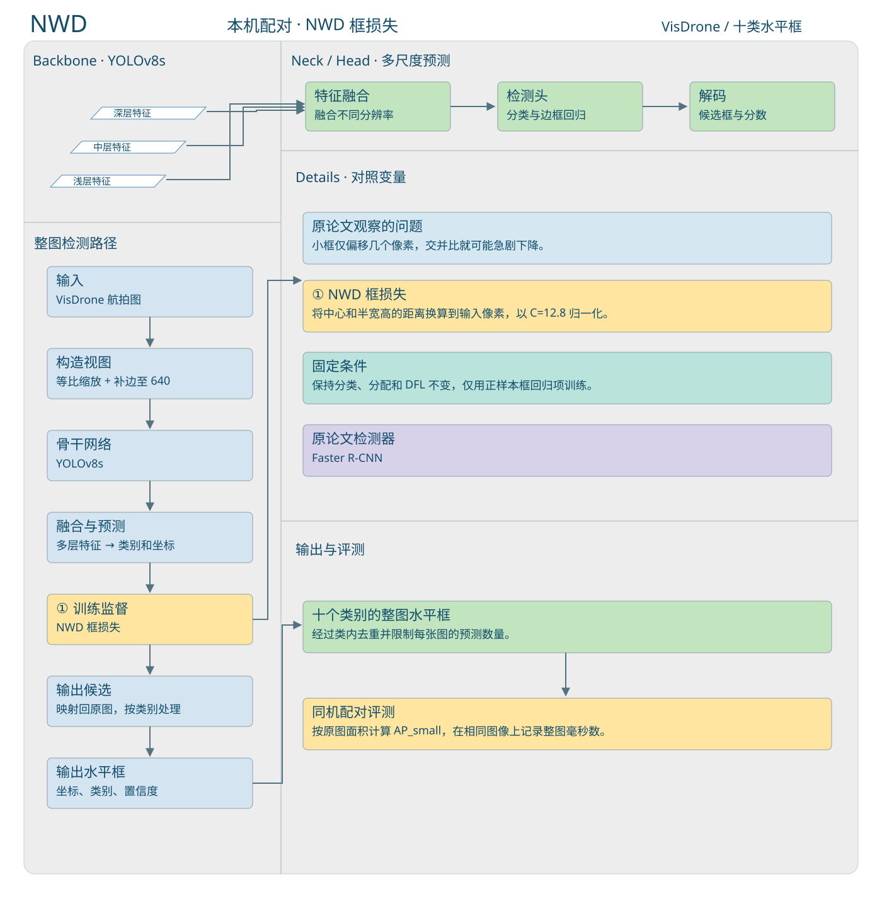

# NWD 的小框回归损失

| 本机基线 · CIoU | 本机方法 · NWD |
|---|---|
|  |  |

**独立训练复现（回归损失迁移）。** 小框挪几个像素，交叠面积就会大幅变化。NWD 用框中心与宽高的距离监督回归，希望训练时对这种偏移更平滑。64 图训练中，一个种子升、一个种子降。现有结果不支持小目标精度稳定提升。

| 种子 | AP_small 基线 → 方法 | 差值（点） | 全类 AP 基线 → 方法 | 整图 ms 基线 → 方法 |
|---|---:|---:|---:|---:|
| 0 | 0.7172 → 0.7407 | +0.0235 | 1.723 → 1.765 | 15.62 → 16.38 |
| 1 | 0.7482 → 0.6846 | −0.0636 | 1.808 → 1.716 | 15.50 → 16.12 |

**文献报告。** Wang 等，*A Normalized Gaussian Wasserstein Distance for Tiny Object Detection*，arXiv 2110.13389v2。表 2 在 AI-TOD 上拆分分配、NMS 和回归；基线 AP 11.1，仅切换 RPN 或 R-CNN 回归损失分别为 12.1、12.4。表 5 另报告 VisDrone 结果。作者仓提供训练配置和定制 MMCV 依赖，README 将模型权重标为待发布。本实验只迁移回归公式，保留 YOLOv8s 原有分配、分类和 DFL。[原文](https://arxiv.org/abs/2110.13389v2) · [作者仓](https://github.com/jwwangchn/NWD/tree/9775ac2d24354895fbdf5b8db1f1600c01c54e33)

**本机协议。** 复用 [RemDet 配对中的 YOLOv8s 基线与环境](../remdet/README.md)，两臂每个种子使用相同 64 张训练图、batch 4、30 轮和 548 张验证图。将各层回归框还原到输入像素，计算 `1−exp(−距离/12.8)`，保留原有损失权重与归一化。[公共说明](../README.md#本轮配对协议)

```powershell
$python = 'reproduce/remdet/local/env/Scripts/python.exe'
foreach ($seed in 0,1) { & $python -m scripts.reproduce.remdet.pair --arm baseline --seed $seed; & $python -m scripts.reproduce.nwd.pair --seed $seed }
```

输出为 `reproduce/nwd/local/seed{0,1}/val.json`。Zotero PDF `HGB6ST29`。
