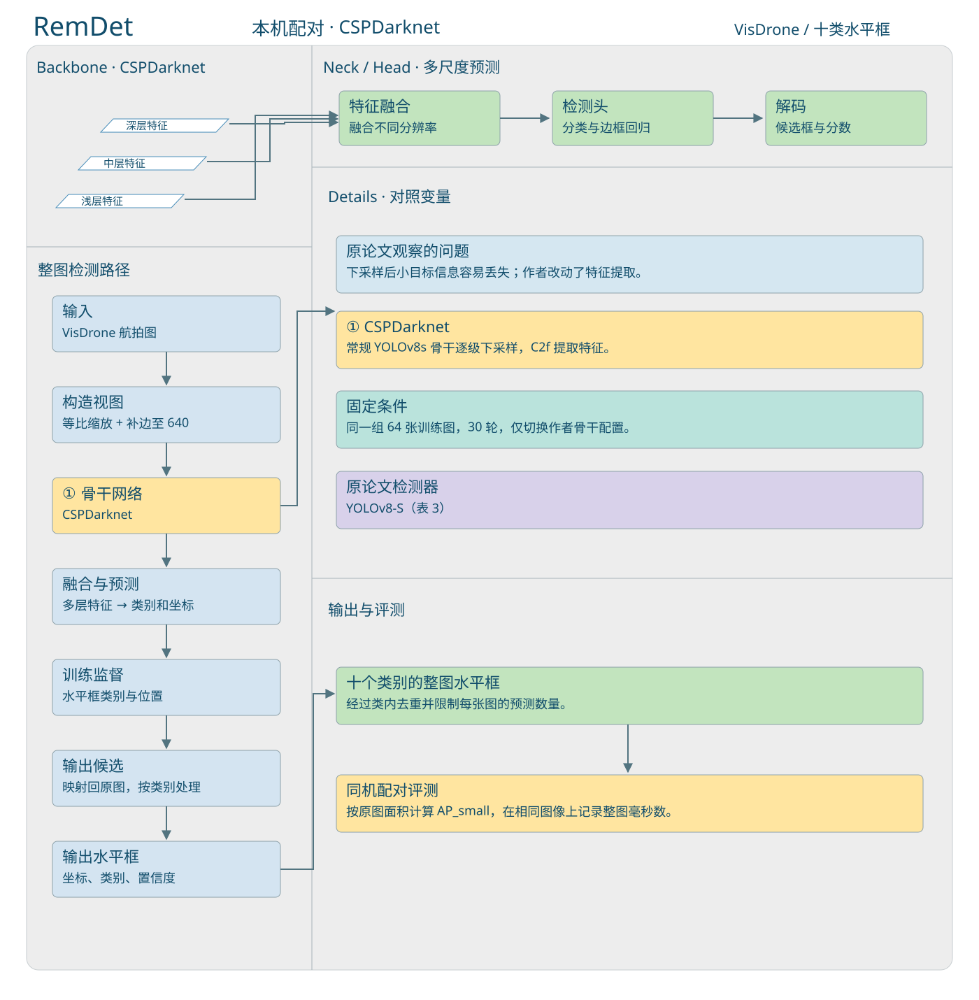
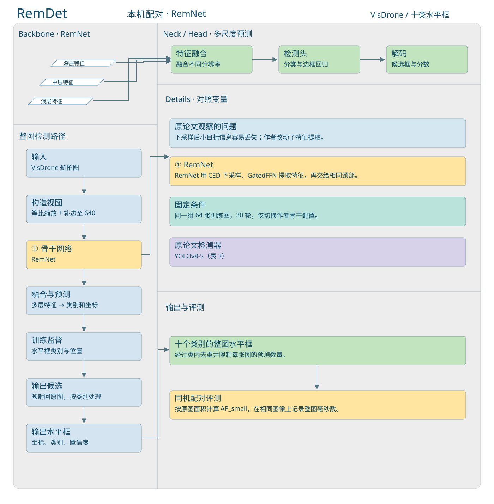

# RemDet 的骨干网络对照

| 作者基线 · YOLOv8-S | 作者方法 · 同一检测器换 RemNet |
|---|---|
|  |  |

**独立训练复现（表 3 骨干替换，小样本）。** 64 张训练图、30 轮、从头训练，两个种子的 AP_small 均下降，整图时间均增加。两臂均在完整 548 张 val 图评测。这组试验支持的是低数据预算下的结论，全量训练效果仍待测。

| 种子 | AP_small 基线 → 方法 | 差值（点） | 全类 AP 基线 → 方法 | 整图 ms 基线 → 方法 |
|---|---:|---:|---:|---:|
| 0 | 0.717 → 0.686 | −0.031 | 1.723 → 1.312 | 15.62 → 16.16 |
| 1 | 0.748 → 0.580 | −0.168 | 1.808 → 1.465 | 15.50 → 16.25 |

**文献报告。** Li 等，*RemDet: Rethinking Efficient Model Design for UAV Object Detection*，AAAI 2025。表 3 的 VisDrone YOLOv8-S 对照，全类 AP 23.1 → 24.6，小目标 AP 13.9 → 15.0。作者提供 VisDrone 训练、评测配置及 RemDet 权重。记录论文值是为确认实验臂，本地差值仅由表中成对数值计算。[论文](https://doi.org/10.1609/aaai.v39i5.32490) · [作者仓](https://github.com/HZAI-ZJNU/RemDet/tree/8cf2667e9ff80122e89436a0ebc6558ff1cfdb93)

**作者权重评测复现。** 独立于上述实验，公开 Tiny 权重在本机 val 得到 AP 21.521、AP_small 12.265、18.07 ms。对应配置 `config_remdet/remdet/remdet_tiny-300e_coco.py` 实际继承 VisDrone 十类设定；同训练配方的 Tiny 基线权重待取得。权重 SHA-256 为 `b9cdaa71ca5d56718326a7a5fe6630b86b6d1c452baf731a9a11c120fb9f7916`。[作者权重](https://drive.google.com/file/d/1oN4FrKJbOh62KhrPzyIoZwWoBlRVhvrr/view)

**本机协议。** 作者 `yolov8_s-300e_visdrone.py` 与 `yolov8_s_remdet-300e_visdrone.py`，统一缩短为 30 轮，固定 64 张训练图，训练时等比缩放、补边、随机翻转，batch 4、SGD 初始学习率 0.01。每图最多 300 框。Windows、RTX 4070 Ti、Python 3.10、torch 1.13.1+cu117、mmcv 2.1.0、mmengine 0.10.7。[公共说明](../README.md#本轮配对协议)

```powershell
reproduce/yolc/local/env/python.exe -m venv --system-site-packages reproduce/remdet/local/env
$python = 'reproduce/remdet/local/env/Scripts/python.exe'
& $python -m pip install mmcv==2.1.0 -f https://download.openmmlab.com/mmcv/dist/cu117/torch1.13.0/index.html
& $python -m pip install mmengine==0.10.7 numpy==1.26.4 timm==0.9.16 transformers==4.38.2 einops shapely tensorboard gdown
& $python -m gdown 1oN4FrKJbOh62KhrPzyIoZwWoBlRVhvrr -O reproduce/remdet/local/remdet_tiny.pth
& $python -m scripts.reproduce.remdet.pair --arm public
foreach ($seed in 0,1) { foreach ($arm in 'baseline','method') { & $python -m scripts.reproduce.remdet.pair --seed $seed --arm $arm } }
```

权重、30 轮日志、逐臂 `val.json` 和 `public-val.json` 位于 `reproduce/remdet/local/`。Zotero PDF `TXTU83PG`。
