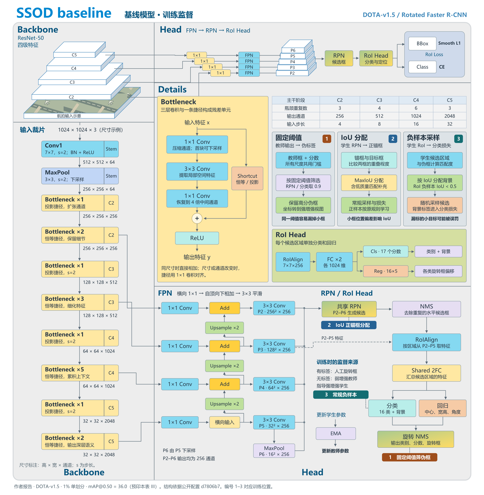

# S³OD 结构图

| 作者基线 · SSOD baseline | 论文方法 · S³OD |
|---|---|
|  |  |

点击预览可放大 SVG。按两张图中的相同编号对照三处变化：① 教师筛选伪框，② 学生 RPN 分配正锚框，③ 学生 RoI 分类处理负样本。

## 复现卡

S³OD 研究航拍半监督检测中的尺度不平衡。作者基线使用在线师生 Rotated Faster R-CNN、ResNet-50/FPN 和固定伪标签阈值。S³OD 改变三个训练位置。

| 图中位置 | 基线面临的问题 | 方法与证据 |
|---|---|---|
| ① 教师筛框（SAT） | 小目标常因置信度偏低被统一阈值滤除 | 按尺度估计阈值。预印本表 IV 的 1% 单划分中，统一 0.9 为 36.0%，尺度自适应为 39.6%。 |
| ② RPN 分配正锚框（SLA） | 小框的轻微位置偏差会使可匹配的锚框变少 | 按几何距离匹配并重加权。表 VI 中基线 36.0%，仅换匹配 36.5%，再加尺度重加权 37.8%。 |
| ③ RoI 处理负样本（TNL） | 漏标目标可能被当作背景 | 教师复核负候选并给困难负例加权。表 III 中单独加入 TNL 为 38.1%。 |

| DOTA-v1.5 验证集，旋转框 mAP@0.50 | 作者基线 | 作者 S³OD | 本机 S³OD | 本机与作者差异 |
|---|---:|---:|---|---|
| 表 III，1% 有标注裁片，单划分 | 36.0% | 41.9% | 待测 | 待测 |
| 表 I，1% 有标注裁片，五划分均值 | 33.30% | 40.02% | 待测 | 待测 |
| 表 I，10% 有标注裁片，五划分均值 | 57.08% | 60.24% | 待测 | 待测 |

以上数据取自 [2023 年预印本 v1](https://arxiv.org/html/2310.14718v1)。[2025 年期刊版](https://doi.org/10.1016/j.isprsjprs.2025.01.037)另包含 SODA-A 实验。公开的 [10% 配置](../../../reproduce/s3od/upstream/configs/dota1.5/s3od_dota1.5_10percent.py)使用 GMM 估计阈值，预印本描述的是按尺度取百分位。复现时需记录实际配置。

作者代码固定在 `d7806b78947cdc403d525e67a28193a88a4f8598`。[启动脚本](../../../reproduce/s3od/upstream/tools/dist_train_partially.sh)引用 `s3od_dota1.5_1percent_test.py`，随后传入 `fold` 和 `percent`。训练前应核对实际载入的裁片划分。目前尚缺 DOTA-v1.5 数据和相应的 S³OD 检查点。

[作者代码、环境说明和绘图脚本](../../../reproduce/s3od/)

### 工程烟测：尺度分界

作者训练入口使用的 1% 配置按 `宽 × 高 < 1024` 汇总小框分数。训练代码调用筛框函数时省略 `small_size`，函数默认按 `< 800` 选择小框阈值。因此面积在 `[800, 1024)` 的框参与小框阈值估计，筛框时却使用普通框阈值。[训练调用](../../../reproduce/s3od/upstream/s3od/models/s3od.py) · [筛框实现](../../../reproduce/s3od/upstream/s3od/models/utils/bbox_utils.py)

在本机 `yolo` 环境运行 `python -m pytest tests/reproduce/s3od`。合成样例得到小框阈值 0.60、普通框阈值 0.90。同为 0.75 分时，28×28 框保留，30×30 和 32×32 框被滤掉；对照调用显式传入 1024 后，30×30 框也被保留。测试只执行固定提交中的 SAT 函数，尚未测量这一差异对真实目标召回或 mAP 的影响。[带中文注释的测试](../../../tests/reproduce/s3od/test_sat.py)
