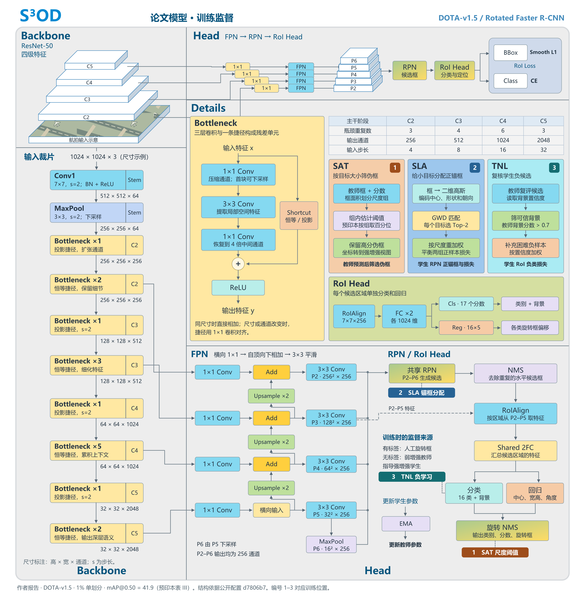

# S³OD 结构图

| 作者基线 · SSOD baseline | 论文方法 · S³OD |
|---|---|
| [](ssod-baseline-architecture.svg) | [](s3od-architecture.svg) |

点击预览可放大 SVG。按两张图中的相同编号对照三处变化：① 教师筛选伪框，② 学生 RPN 分配正锚框，③ 学生 RoI 分类处理负样本。

## 复现卡

S³OD 研究航拍半监督检测中的尺度不平衡。作者基线使用在线师生 Rotated Faster R-CNN、ResNet-50/FPN 和固定伪标签阈值。S³OD 改变三个训练位置。

| 图中位置 | 基线面临的问题 | 方法与证据 |
|---|---|---|
| ① 教师筛框（SAT） | 小目标常因置信度偏低被统一阈值滤除 | 按尺度估计阈值。预印本表 IV 的 1% 单划分中，统一 0.9 为 36.0%，尺度自适应为 39.6%。 |
| ② RPN 分配正锚框（SLA） | 小框的轻微位置偏差会使可匹配的锚框变少 | 按几何距离匹配并重加权。表 VI 中基线 36.0%，仅换匹配 36.5%，再加尺度重加权 37.8%。 |
| ③ RoI 处理负样本（TNL） | 漏标目标可能被当作背景 | 教师复核负候选并给困难负例加权。表 III 中单独加入 TNL 为 38.1%。 |

| DOTA-v1.5 验证集，旋转框 mAP@0.50 | 作者基线 | 作者 S³OD | 本机 S³OD | 本机与作者差异 |
|---|---:|---:|---|---|
| 表 III，1% 有标注裁片，单划分 | 36.0% | 41.9% | 待测 | 待测 |
| 表 I，1% 有标注裁片，五划分均值 | 33.30% | 40.02% | 待测 | 待测 |
| 表 I，10% 有标注裁片，五划分均值 | 57.08% | 60.24% | 待测 | 待测 |

以上数据取自 [2023 年预印本 v1](https://arxiv.org/html/2310.14718v1)。[2025 年期刊版](https://doi.org/10.1016/j.isprsjprs.2025.01.037)另包含 SODA-A 实验。公开的 [10% 配置](../../../reproduce/s3od/upstream/configs/dota1.5/s3od_dota1.5_10percent.py)使用 GMM 估计阈值，预印本描述的是按尺度取百分位。复现时需记录实际配置。

作者代码固定在 `d7806b78947cdc403d525e67a28193a88a4f8598`。[启动脚本](../../../reproduce/s3od/upstream/tools/dist_train_partially.sh)引用 `s3od_dota1.5_1percent_test.py`，随后传入 `fold` 和 `percent`。训练前应核对实际载入的裁片划分。目前尚缺 DOTA-v1.5 数据和相应的 S³OD 检查点。

[作者代码、环境说明和绘图脚本](../../../reproduce/s3od/)

### 原协议复现状态

| 证据 | 当前状态 |
|---|---|
| 文献报告 | 预印本表 I 的 10% 有标注裁片设置，作者基线 57.08±0.74，S³OD 60.24±0.42 mAP@0.50。SAT 单模块的 +3.6 点来自表 III 的 1% 单划分。 |
| 代码运行 | 本机执行了作者 SAT 函数的合成测试和 VisDrone 离线评测。完整旋转检测框架待配置。 |
| 作者权重评测 | 待测。固定提交和发布页未找到 S³OD 检查点。本机也缺 DOTA-v1.5 验证图与标注。 |
| 独立训练 | 待测。还需准备 DOTA-v1.5 和核对五次有标注/无标注裁片划分。 |

匹配原协议的检查点和验证裁片就位后，在作者环境和 `reproduce/s3od/upstream` 下评测。下面的命令尚未运行，配置使用 teacher 分支和旋转框 IoU 0.50。

```bash
PYTHONPATH=. python tools/test.py configs/dota1.5/s3od_dota1.5_10percent.py \
  /path/to/s3od_dota15_10percent_fold_checkpoint.pth --eval mAP \
  --eval-options iou_thr=0.5
```

### 工程烟测：尺度分界

作者训练入口使用的 1% 配置按 `宽 × 高 < 1024` 汇总小框分数。训练代码调用筛框函数时省略 `small_size`，函数默认按 `< 800` 选择小框阈值。因此面积在 `[800, 1024)` 的框参与小框阈值估计，筛框时却使用普通框阈值。[训练调用](../../../reproduce/s3od/upstream/s3od/models/s3od.py) · [筛框实现](../../../reproduce/s3od/upstream/s3od/models/utils/bbox_utils.py)

在本机 `yolo` 环境运行 `python -m pytest tests/reproduce/s3od`。合成样例得到小框阈值 0.60、普通框阈值 0.90。同为 0.75 分时，28×28 框保留，30×30 和 32×32 框被滤掉。对照调用显式传入 1024 后，30×30 框也被保留。这个测试隔离了分界差异的影响。[带中文注释的测试](../../../tests/reproduce/s3od/test_sat.py)

### VisDrone SAT 离线评测

在同一批 548 张 VisDrone 验证集原图上，冻结归档中 YOLO11s Detect + B2 两个种子的 100 轮 `last.pt`，将它们分别作为产出候选框的检测器。每个种子的所有筛框策略使用同一组 NMS 后候选。SAT 沿用作者公开代码的 GMM、阈值回退和 1024/800 面积分界。评测用原图真值框面积 `< 1024` 定义小目标，按同类 IoU≥0.50 一对一匹配。未匹配框在忽略区内的面积超过自身面积一半时，不计入假阳性。

| 种子 | 筛框策略 | 保留伪框 | 小目标命中 / 26,575 | 小目标召回 | 全部伪框精度 |
|---|---|---:|---:|---:|---:|
| 0 | B2 统一 0.50 | 11,716 | 2,961 | 11.14% | 88.24% |
| 0 | 统一分数排序，保留与 SAT 同样多 | 6,280 | 653 | 2.46% | 94.09% |
| 0 | SAT | 6,280 | 1,752 | 6.59% | 92.12% |
| 1 | B2 统一 0.50 | 11,740 | 2,947 | 11.09% | 88.33% |
| 1 | 统一分数排序，保留与 SAT 同样多 | 6,418 | 700 | 2.63% | 94.14% |
| 1 | SAT | 6,418 | 1,767 | 6.65% | 92.84% |

等量时，两个种子分别多匹配 1,099 和 1,067 个小目标，全部伪框精度分别下降 1.97 和 1.30 个百分点。以当前 B2 的 0.50 为对照，SAT 的小目标召回分别下降 4.55 和 4.44 个百分点。每批由 8 图改为 4 图后，两个种子的小目标召回差相对等量对照依然为正（+3.97、+3.92 个百分点），相对统一 0.50 依然为负（−6.08、−6.16 个百分点）。SAT 在不同批量下保留的伪框数量变化明显。

再用当初给 B2 生成伪标签的 B1 教师 `partial10_sup_s0/weights/best.pt` 做同样的整图配对，批量为 8。SAT 保留 5,741 个伪框，命中 1,600 个小目标，召回 6.02%。统一分数等量筛选命中 507 个，召回 1.91%。统一 0.50 保留 11,401 个，命中 2,797 个小目标，召回 10.52%。三者全部伪框精度分别为 92.52%、94.34%、88.47%。

此次验证范围为 VisDrone 验证整图、输入边长 640 下的伪框筛选。历史 B2 生成伪标签时用的是训练集未标注裁片、输入边长 960。该裁片协议上的筛框表现和新训练学生的 mAP 仍待测。

复跑在仓库根目录、现有 `yolo` 环境执行。环境为 Python 3.12.4、PyTorch 2.10.0+cu128、Ultralytics 8.4.172、scikit-learn 1.7.2 和 RTX 4070 Ti。NMS IoU 为 0.70，候选置信度下限为 0.001，最多保留每图 1000 个候选。SAT 每批估阈值，输入按图名排序。逐图计数、每批阈值及权重 SHA-256 写入本机 JSON，权重哈希已与归档清单核对。

```powershell
$runs = 'cache/2026-11-24-RegionSSOD/worktree/runs'
python -m scripts.reproduce.s3od.evaluate_sat_visdrone `
  "$runs/partial10_b2_formal100_s0/weights/last.pt" `
  "$runs/partial10_b2_formal100_s1/weights/last.pt" `
  --batch 8 --output reproduce/s3od/local/visdrone_sat_b2_val.json
```

将 `--batch` 改为 `4` 并另设输出文件，可复跑批量敏感性对比。仅传入 `"$runs/partial10_sup_s0/weights/best.pt"`，按批量 8 运行并将结果另存为 `reproduce/s3od/local/visdrone_sat_b1_val.json`，可复跑 B1 教师对比。
