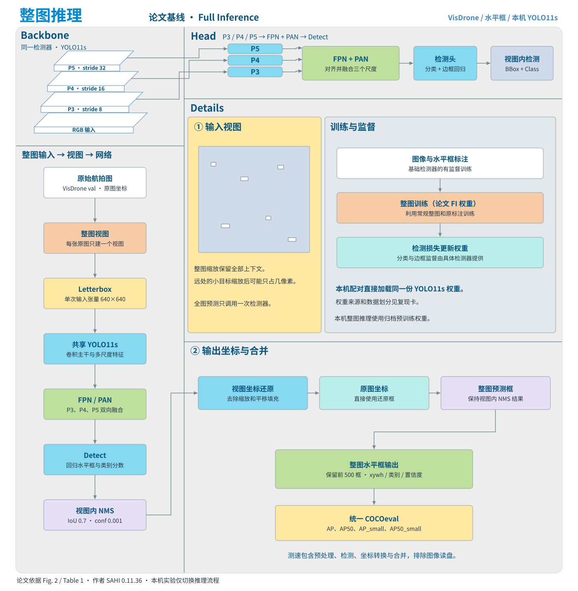
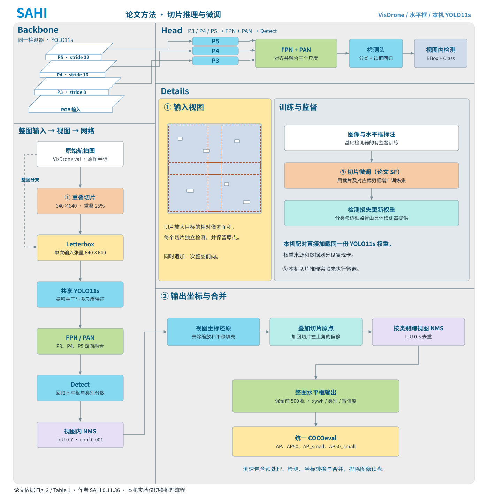

# SAHI 切片推理本机复现卡

| 论文基线 Full Inference（本机以 YOLO11s 实例化） | 论文方法 SAHI（本机验证切片推理） |
|---|---|
|  |  |

## 本机结论

**权重评测复现（切片推理迁移到 YOLO11s）**。在 VisDrone val 的同图、同权重对照中，两份裁片训练的权重开启 SAHI 后，小目标 AP 分别增加 **11.88** 和 **11.53** 点。每张原图的检测器调用次数由 1 次增至平均 6.19 次，包括追加的整图视图。切片带来了可重复的精度收益，同时增加了整图耗时。整篇论文的独立训练复现仍待验证，包括 SF 微调和原模型的 test-dev 评测。

| 训练种子 | 推理 | AP | AP50 | AP_small | AP50_small |
|---|---|---:|---:|---:|---:|
| 0 | 整图 | 16.096 | 27.251 | 6.771 | 15.580 |
| 0 | SAHI + 整图 | 27.781 | 45.680 | 18.654 | 35.832 |
| 1 | 整图 | 16.392 | 27.650 | 6.903 | 15.839 |
| 1 | SAHI + 整图 | 27.707 | 45.601 | 18.434 | 35.581 |

同一权重和推理方式的两轮四项精度指标一致。下表每格的耗时统计基于完整的 548 张验证图，单位为毫秒。两轮倒序后，切片的平均单图耗时均高于整图推理，达到同轮基线的 **16.61–20.27 倍**。

| 种子 | 轮次及先后顺序 | 整图平均 / P95 | 切片平均 / P95 | 平均耗时比 |
|---|---|---:|---:|---:|
| 0 | 1 · 整图→切片 | 27.17 / 37.38 | 476.13 / 1010.93 | 17.52× |
| 0 | 2 · 切片→整图 | 32.97 / 42.68 | 547.78 / 1153.67 | 16.61× |
| 1 | 1 · 整图→切片 | 29.25 / 40.13 | 550.67 / 1147.32 | 18.83× |
| 1 | 2 · 切片→整图 | 19.12 / 24.51 | 387.63 / 714.72 | 20.27× |

本机原始结果位于 `reproduce/sahi/local/val-pair.json`，含 8 组指标、权重散列和每次推理的逐图耗时。耗时比反映当前串行切片、低置信度和跨视图合并的整套实现。

## 论文本身验证了什么

Fatih Cagatay Akyon、Sinan Onur Altinuc、Alptekin Temizel 在 ICIP 2022 发表 *Slicing Aided Hyper Inference and Fine-Tuning for Small Object Detection*。Fig. 2 给出了切片微调（SF）和切片推理（SAHI）两条路径。切片推理将高分辨率图像切成重叠视图并独立检测，回到原图坐标后合并预测，借此保留远处小目标的有效像素。VisDrone2019-DET test-dev 的 Table 1 以 FCOS、VFNet、TOOD 整图推理为基线，报告 AP50 和不同尺度的 AP50，使用 640×640 切片、25% 重叠和 0.5 的合并阈值。作者证据支持切片可以提升小目标精度。[IEEE 正式版](https://doi.org/10.1109/ICIP46576.2022.9897990) · [arXiv v5](https://arxiv.org/abs/2202.06934v5)

切片推理使用作者 SAHI `0.11.36`，固定提交 `68e61981e1f79c56299c208df1d5bac03a01811d`。作者库提供切片与合并实现，配套评测仓库公开实验配置、预测文件，以及切片微调后的 VisDrone FCOS 和 TOOD 权重。三种整图训练模型对应的 FI 权重均标记为 `request`。本机评测直接使用两份归档 YOLO11s 权重，各自在推理阶段成对开关切片。[作者实现](https://github.com/obss/sahi/tree/68e61981e1f79c56299c208df1d5bac03a01811d) · [作者评测仓库](https://github.com/fcakyon/small-object-detection-benchmark/blob/main/README.md)

## 本机评测协议

| 要素 | 本机设置 |
|---|---|
| 数据 | 官方 VisDrone2019-DET val 全部 548 张，十类 HBB。按本仓库 ESOD 的评测入口涂灰忽略区、排除 truncation ≥ 2 框。 |
| 权重 | 归档的 `partial10_b2_formal100_s0`、`partial10_b2_formal100_s1`，训练日志均有 100 个 epoch，各取 `weights/best.pt`。两份权重都接受过裁片训练，最佳检查点使用 val 选择。两臂使用同一检查点。 |
| 两臂共有 | 每次前向 640×640、FP32、单图、置信度 0.001、视图内类别感知 NMS IoU 0.7，最终保留每张原图最高分的 500 框。 |
| 整图推理 | 单张原图做一次 letterbox 和检测。 |
| SAHI | 640×640、25% 重叠，追加整图视图。还原坐标后按类别使用 IoU 0.5 的 NMS 去重。 |
| 指标 | 在同一 COCOeval 真值上计算 AP、AP50、AP_small 和 AP50_small。小目标采用原图框面积小于等于 32² 的 COCO 划分。 |
| 计时 | RTX 4070 Ti，CUDA 同步，FP32。每臂先预热 10 张，在内存图像上计时，涵盖模型预处理、检测、坐标还原、合并和截断前排序。读盘、忽略区准备和 COCOeval 在计时区间外执行。每份权重先后运行整图→切片、切片→整图。 |

两份权重沿用旧项目中相同的数据和训练方案。11,095 张训练裁片可追溯到 VisDrone train 的 6,471 张原图，与本轮 val 的原图文件名交集为零。裁片训练可能放大切片推理的收益；用常规整图训练的 YOLO 权重能否得到相同增幅，仍需单独配对验证。原论文使用 test-dev，本机使用 val。

运行环境为 Python 3.12.4、PyTorch 2.10.0+cu128、Ultralytics 8.4.172、OpenCV 4.11.0。本机 val 经过忽略区和截断处理后保留 38,759 个有效框。两份权重 SHA-256 依次为 `b9e04e8c23b1c9bd49e3badad4930c1a8bb77e3db6931d6dcc84becfdbbc7691` 和 `cf72dd9b533b6fd07874dde725525f50e2b860bdc8444ba8d322e2a2e9039d69`。

作为文献记录，Table 1 中普通训练的 FCOS、VFNet、TOOD 从 FI 切换到 SAHI+FI+PO，AP50_small 分别为 14.2→19.8、16.8→22.4、18.1→23.8。复现判定使用本机两臂的差值。[论文 Table 1](https://arxiv.org/pdf/2202.06934v5)

```powershell
git submodule update --init reproduce/sahi/upstream
$python = "$env:USERPROFILE/.conda/envs/yolo/python.exe"
& $python -m venv --system-site-packages reproduce/sahi/local/env
$sahiPython = "reproduce/sahi/local/env/Scripts/python.exe"
& $sahiPython -m pip install sahi==0.11.36
$env:YOLO_CONFIG_DIR = (Resolve-Path reproduce/sahi/local).Path
$weights = 0,1 | ForEach-Object { "cache/2026-11-24-RegionSSOD/worktree/runs/partial10_b2_formal100_s$_/weights/best.pt" }
& $sahiPython -m scripts.reproduce.sahi.evaluate_visdrone --weights @weights --output reproduce/sahi/local/val-pair.json
& $sahiPython reproduce/sahi/figures/draw_pair.py
```

## 候选论文与复现条件

| 候选 | 对当前方向的用途 | 作者公开材料与下一组本机对照 |
|---|---|---|
| RemDet，AAAI 2025 | 直接竞争方法。以 ChannelC2f、GatedFFN 和 CED 改善小而密集目标的检测，在同一模型中关注延迟。 | 作者提供 VisDrone 配置、训练评测代码、日志和 Tiny 至 X 的方法权重。Table 1 在原图 640 设置下列有 RemDet-Tiny、YOLOv8-N 和 RTMDet-Tiny。已查到的权重表只列 RemDet 系列。在本机比较整模型前，还需取得或训练同划分的对照权重，统一测小目标 AP 与整图延迟。 [论文](https://doi.org/10.1609/aaai.v39i5.32490) · [代码](https://github.com/HZAI-ZJNU/RemDet) |
| YOLC，IEEE T-ITS 2024 | 局部聚类放大思路。使用 CenterNet 检测头，结合聚类局部放大、回归损失和可变形结构处理小目标。 | 作者发布训练评测配置、VisDrone val COCO 标注和 YOLC 权重。要重评完整方法，需对应的 CenterNet 基线权重。固定同一个 YOLC 权重开关局部放大可以单独检验该机制。 [论文](https://doi.org/10.1109/TITS.2024.3386928) · [代码](https://github.com/dawn-ech/YOLC) |

初筛时已核验 RemDet-Tiny 和 YOLC 检查点的下载入口，总大小分别为 36,310,288 和 546,030,703 字节。RemDet 当前只有文献及资源核验记录；YOLC 的后续实验见[本机复现卡](../yolc/README.md)。核验时的仓库版本分别为 [RemDet `8cf2667`](https://github.com/HZAI-ZJNU/RemDet/tree/8cf2667e9ff80122e89436a0ebc6558ff1cfdb93)、[YOLC `3b42257`](https://github.com/dawn-ech/YOLC/tree/3b42257ca18d212f7c24ed82eaa7e050d3d6e33d) 和 [SAHI benchmark `d923428`](https://github.com/fcakyon/small-object-detection-benchmark/tree/d923428f380763dec2bd809cd4f7d532c6e00d03)。

三篇候选的 PDF 已收录在 Zotero 的 `Research / YOLO-RegionSSOD / 无人机水平框小目标检测`，其中 SAHI 位于同名子分类。该分类还收录了定义评测任务的 VisDrone-DET2019 挑战报告。[挑战原文](https://openaccess.thecvf.com/content_ICCVW_2019/html/VISDrone/Du_VisDrone-DET2019_The_Vision_Meets_Drone_Object_Detection_in_Image_Challenge_ICCVW_2019_paper.html) · [VisDrone 数据与任务](https://github.com/VisDrone/VisDrone-Dataset)
