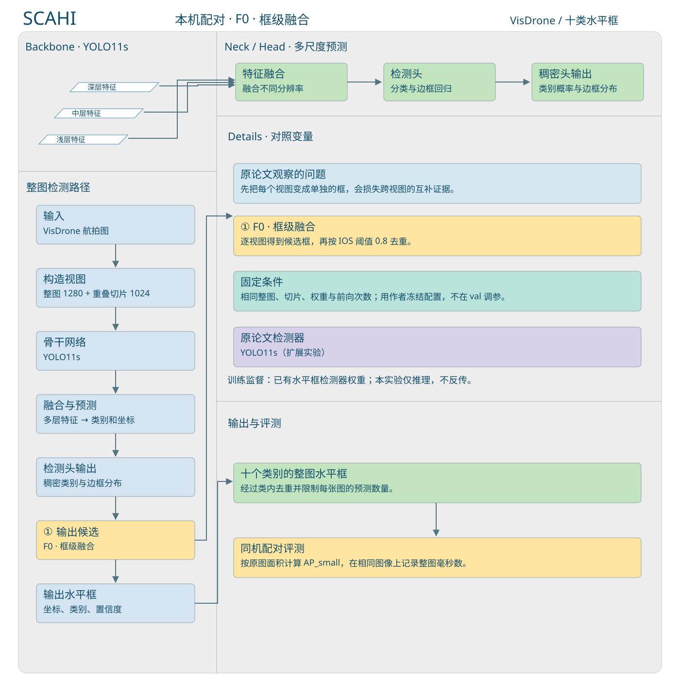
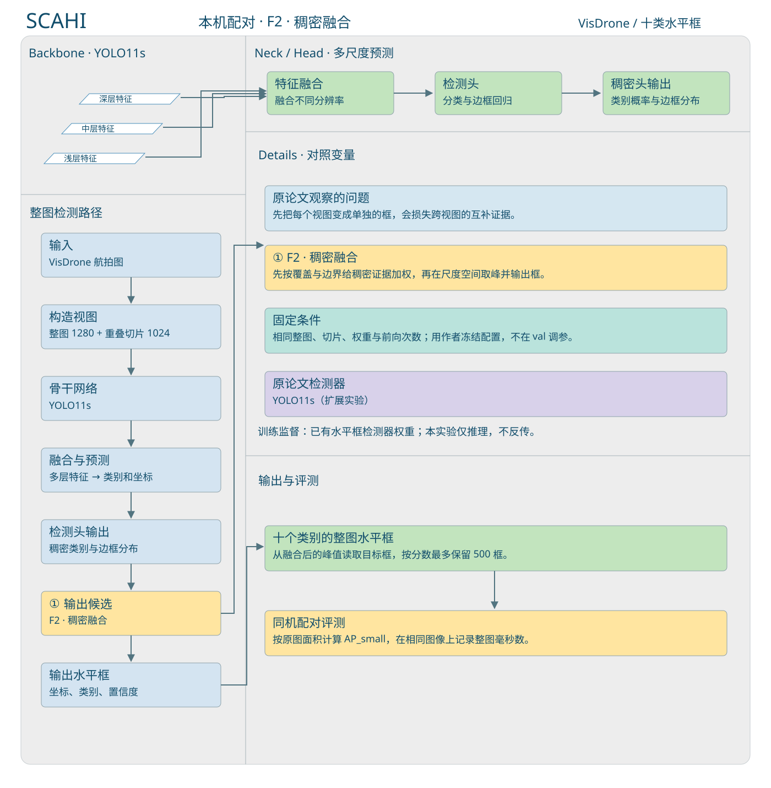

# SCAHI：相同切片，先融合检测证据还是先选框？

| 作者基线 F0：框级去重 | 作者方法 F2：稠密证据融合 |
|---|---|
|  |  |

**权重评测（作者推理实现迁移，不是独立训练）**。在 VisDrone val 全部 548 图上，换成 F2 后，两份本机 YOLO11s 权重的小目标 AP 都提高；没有整图提速。两臂看完全相同的整图和切片。因此这不是「模型多看了几块」带来的收益。

| 权重 | F0 → F2 小目标 AP | 差值（点） | 总体 AP | 均值 ms/原图 |
|---|---:|---:|---:|---:|
| 0 | 27.047 → 27.888 | +0.840 | 33.722 → 35.481 | 266.22 → 267.02 |
| 1 | 27.149 → 28.108 | +0.958 | 33.799 → 35.477 | 265.43 → 287.63 |

[论文](https://arxiv.org/abs/2611.12657) *When Does Sliced Inference Pay Off? Resolution, Tiling and Dense Fusion for Small Object Detection*（2026 预印本）。原文表 2 的 YOLOv10s 在 2048 + tiles 上，val AP 从 38.85 到 39.34；这里只作为原文主张的出处，并非本机基线。实际运行 [作者训练、推理和评测仓库](../../../reproduce/scahi/upstream/) `e30796121b7b0fc8ee736c7c6632a2427c8ee098` 的 YOLO11s 扩展行。作者训练权重和数据不作为此次输入。

两臂固定 `w1280 + t2.0n1024`、重叠 0.3、batch 1、one-to-many 头。F0 用 `NMS-IOS=0.8, conf=0.01`；F2 用 `tau_splat=0.005, tau_peak=0.001, cell_factor=5, bins_per_oct=5`，先在尺度空间聚合后读出峰值。两者是两整套冻结的合并规则，不能归因到某个子参数。每图最多 500 框。[本机权重、软硬件与忽略区协议](../README.md#本轮配对协议)。原始逐臂值、P95、权重 SHA-256 在 `reproduce/scahi/local/val-548.json`。Zotero PDF `NH22NAMB`。

```powershell
git submodule update --init reproduce/scahi/upstream
reproduce/sahi/local/env/Scripts/python.exe -m pip install --no-deps sahi==0.12.8 --target reproduce/scahi/local/deps
reproduce/sahi/local/env/Scripts/python.exe -m scripts.reproduce.scahi.evaluate
```

结论限于上述两份权重和 val；未证明从头训练稳定或与其他方法组合仍有同等增量。两图烟测不计入结果。
