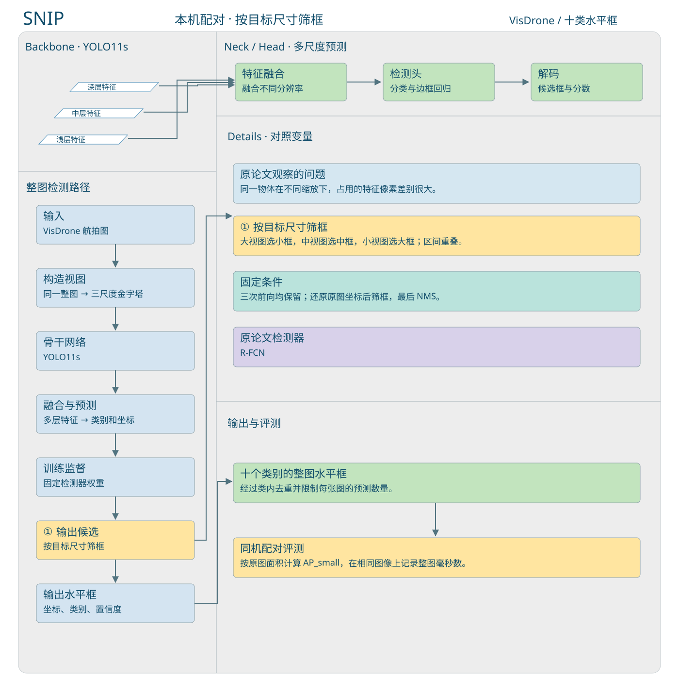

# SNIP 的推理尺度筛框

| 本机基线 · 全部尺度参与合并 | 本机方法 · 各尺度只保留相应尺寸的框 |
|---|---|
|  |  |

**推理机制迁移，权重评测复现。** 同一张图放大后，小车在输入中更清楚；缩小后，大车仍然可辨。两组都看同样的三张图。区别在于合并时要不要让缩小图上的小车框也参与竞争。两份权重开启筛框，小目标 AP 都提高约 0.61 点。

| YOLO11s 权重种子 | AP_small 基线 → 方法 | 差值（点） | 全类 AP 基线 → 方法 | 整图 ms 基线 → 方法 |
|---|---:|---:|---:|---:|
| 0 | 25.571 → 26.176 | +0.606 | 33.442 → 33.825 | 47.77 → 45.85 |
| 1 | 25.683 → 26.296 | +0.614 | 33.517 → 33.981 | 46.11 → 46.69 |

**原参数复核 test-dev 1,610 张。** 两份权重均在相同的三尺度基线上获得小目标收益。全类 AP 与延迟的变化方向在两个种子间不同。

| 权重种子 | AP_small 基线 → 方法 | 差值（点） | 全类 AP 基线 → 方法 | 整图 ms 基线 → 方法 |
|---|---:|---:|---:|---:|
| 0 | 14.870 → 15.341 | +0.471 | 24.571 → 24.672 | 72.35 → 73.23 |
| 1 | 14.790 → 15.051 | +0.261 | 24.456 → 24.439 | 71.40 → 62.71 |

**文献报告。** Singh 与 Davis 的 *An Analysis of Scale Invariance in Object Detection – SNIP*（CVPR 2018，arXiv v2）同时讨论训练和推理尺度。表 1 中 R-FCN/ResNet-50 的小目标 mAP 从多尺度训练的 19.5 升至 SNIP 的 21.4。作者原仓指向后续 SNIPER 实现；本机采用其中 `configs/faster/sniper_res101_e2e.yml` 的测试尺度和 `lib/inference.py` 的筛框规则。该仓有训练、检测和 COCO 模型说明，VisDrone 数据与本机检测权重另取。此次只检验测试尺度筛框，SNIP 尺度训练与 SNIPER 芯片训练均未验证。[论文](https://doi.org/10.1109/CVPR.2018.00377) · [固定作者代码](https://github.com/mahyarnajibi/SNIPER/tree/66d7d5bff7f2e1e45e7e299c570e43e8698311aa)

**本机协议。** 短边目标/长边上限分别为 1400/2000、800/1280、480/512；各视图等比缩放，补齐到 32 倍数。各尺度推理置信度 0.001、NMS IoU 0.7，映射回原图后按框面积平方根筛选，各尺度有效范围依次为 ≤90、(32,180]、>75 像素，两臂统一跨尺度 NMS IoU 0.5。输入、历史裁片权重来源、548 图 VisDrone val 协议和环境见[公共说明](../README.md#本轮配对协议)。单图延迟的方向在两组之间发生变化。

```powershell
reproduce/sahi/local/env/Scripts/python.exe -m scripts.reproduce.snip.evaluate
reproduce/sahi/local/env/Scripts/python.exe -m scripts.reproduce.snip.evaluate --split test
```

逐臂数值、权重 SHA-256 与 P95 见本机 `reproduce/snip/local/{val-548,test-1610}.json`。Zotero 已归入本项目 SNIP 子分类，PDF `88ZLY5HR`。
