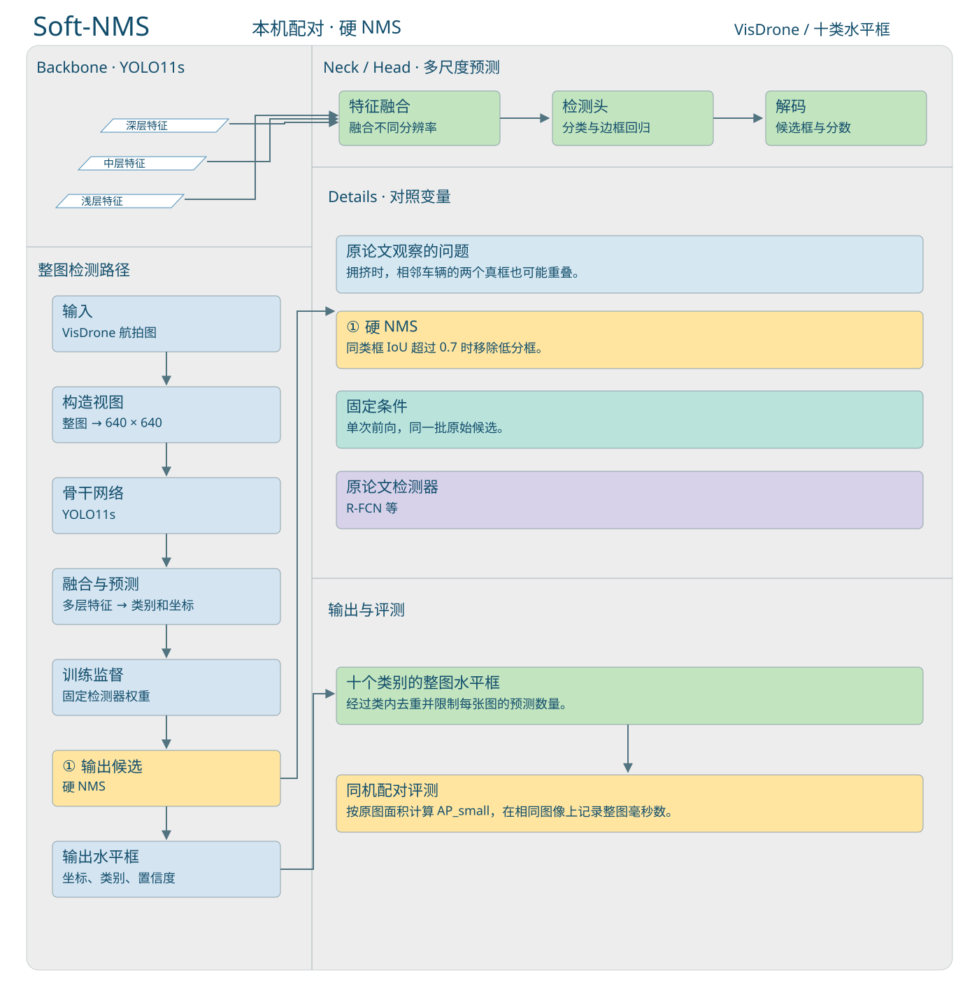
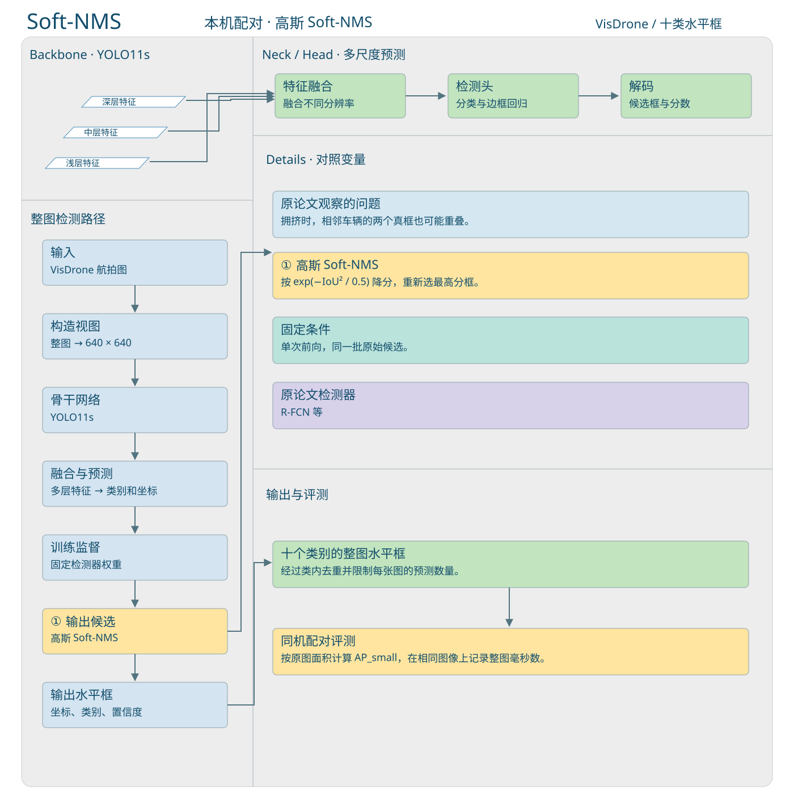

# Soft-NMS 的重叠框降分

| 本机基线 · 硬 NMS | 本机方法 · 高斯 Soft-NMS |
|---|---|
|  |  |

**推理机制迁移，权重评测复现。** 两辆车贴得很近时，框可能重叠。硬 NMS 会一次删掉低分框，Soft-NMS 给重叠框降分，位置略有区别的车还有机会留下。实验直接取同一检测头的原始候选，测试这种变化对小目标精度的净影响。

| VisDrone val 权重种子 | AP_small 基线 → 方法 | 差值（点） | 全类 AP 基线 → 方法 | 整图 ms 基线 → 方法 |
|---|---:|---:|---:|---:|
| 0 | 6.784 → 6.937 | +0.154 | 16.093 → 16.182 | 9.28 → 9.60 |
| 1 | 6.903 → 7.026 | +0.123 | 16.392 → 16.463 | 10.38 → 10.38 |

**固定设置换到 test-dev 全部 1,610 张。** 权重 0 的 AP_small 从 3.419 升至 3.502（+0.083），权重 1 从 3.428 升至 3.507（+0.079）。全类 AP 分别从 11.471 到 11.462、11.446 到 11.416。平均整图耗时分别从 9.03 到 16.88 ms、17.56 到 17.76 ms，两臂执行顺序交叉，两次基线时间差异较大。这支持在该测试划分上复现小框收益，总体精度与速度提升均无相应证据。

**文献报告。** Bodla 等，*Soft-NMS – Improving Object Detection With One Line of Code*，ICCV 2017，arXiv 1704.04503。表 1 的 COCO test-dev D-RFCN 硬 NMS → 高斯 Soft-NMS，AP 37.4 → 38.4，小目标 AP 17.8 → 18.5。作者提供 Soft-NMS 算法和集成检测代码，实验使用本机 VisDrone 检测器权重。Numba 版本按作者高斯公式逐类降分，坐标采用 YOLO 连续边界。[原文](https://doi.org/10.1109/ICCV.2017.593) · [作者实现](https://github.com/bharatsingh430/soft-nms/tree/b8e69bdf8df2ad53025c9d198ded909b50471d4f)

**本机协议。** 两臂 640×640 单次 FP32 前向，同类硬 NMS IoU 0.7 对高斯 σ=0.5，最低置信度 0.001，每图至多 500 框。基线在 GPU 去重，本机方法在 CPU 降分，耗时含传输。验证集和 test-dev 均使用相同参数。[公共说明](../README.md#本轮配对协议)

```powershell
reproduce/sahi/local/env/Scripts/python.exe -m scripts.reproduce.softnms.evaluate
reproduce/sahi/local/env/Scripts/python.exe -m scripts.reproduce.softnms.evaluate --split test
```

原始文件在本机 `reproduce/softnms/local/{val-548,test-1610}.json`。Zotero 项目子分类已回读，PDF `TG9JW4BB`。
