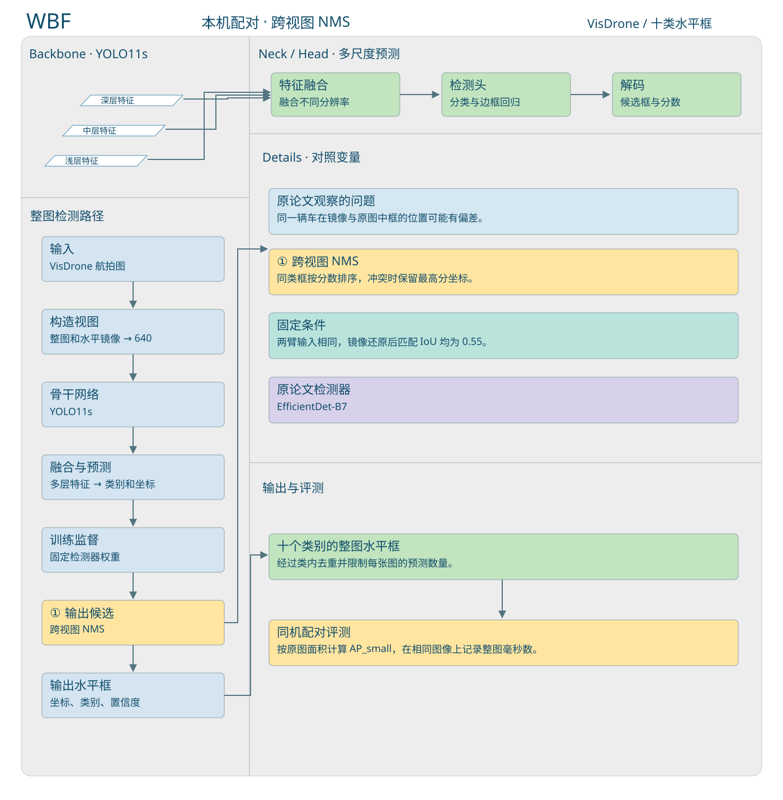

# WBF 的双视图框融合

| 本机基线 · 跨视图硬 NMS | 本机方法 · 加权坐标融合 |
|---|---|
|  |  |

**推理机制迁移，权重评测复现。** 两组都看原图和水平镜像，然后把框放回同一坐标系。WBF 将认为来自同一目标的框按置信度取平均。两份 YOLO11s 权重的小目标 AP、总体 AP 均下降，融合耗时也上升。

| 权重种子 | AP_small 基线 → 方法 | 差值（点） | 全类 AP 基线 → 方法 | 整图 ms 基线 → 方法 |
|---|---:|---:|---:|---:|
| 0 | 7.317 → 6.853 | −0.464 | 16.970 → 16.654 | 12.50 → 19.49 |
| 1 | 7.592 → 7.228 | −0.364 | 17.199 → 16.849 | 12.63 → 18.38 |

**文献报告。** Solovyev 等，*Weighted Boxes Fusion: Ensembling Boxes for Object Detection Models*，Image and Vision Computing，2021，arXiv 1910.13302。表 2 的 EfficientDet-B7 原图+镜像实验，COCO mAP 从 NMS 的 0.5233 到 WBF 的 0.5262。作者提供融合函数，输入为各视图的框、类别与置信度；检测训练与权重由调用方提供。[原文](https://doi.org/10.1016/j.imavis.2021.104117) · [作者实现](https://github.com/ZFTurbo/Weighted-Boxes-Fusion/tree/651884c5c7df13a920d286404b47c6fa86944782)

**本机协议。** 每视图 640×640，置信度 0.001，视图内 NMS IoU 0.7。跨视图匹配 IoU 都为 0.55，WBF 直接调用作者函数，两个视图等权，两臂统一取前 500 框。固定配置在 548 张 VisDrone val 图上验证，未搜索最佳阈值。[公共说明](../README.md#本轮配对协议)

```powershell
reproduce/sahi/local/env/Scripts/python.exe -m scripts.reproduce.wbf.evaluate
```

完整结果 `reproduce/wbf/local/val-548.json`。Zotero 项目子分类已回读，PDF `VLDF829P`。
