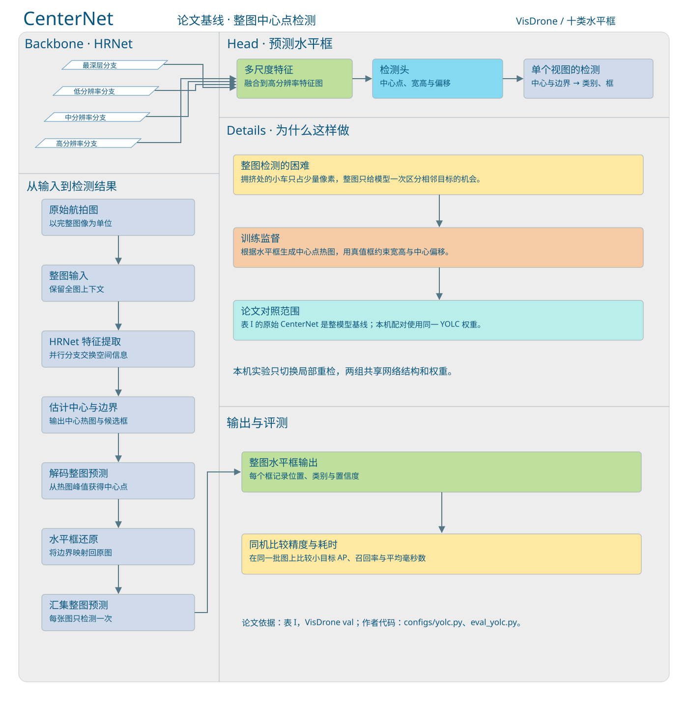
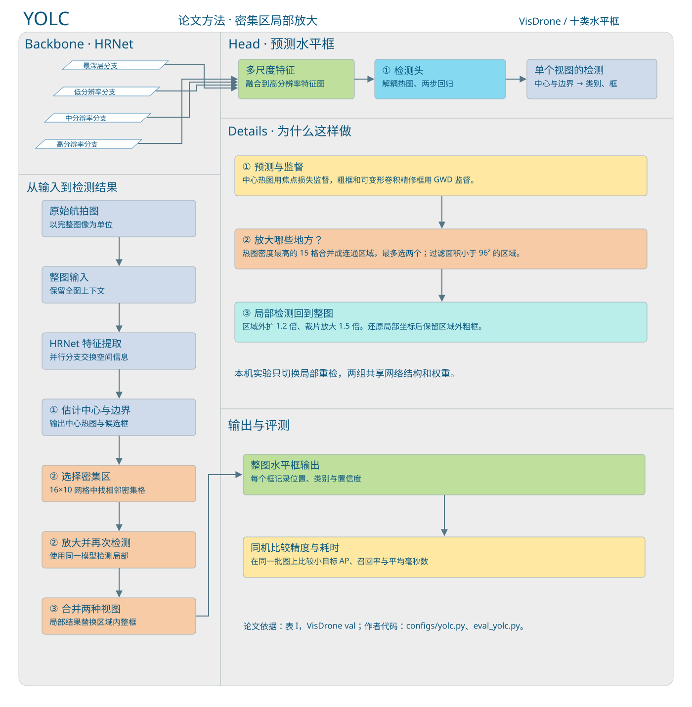

# YOLC 局部放大复现卡

| 论文基线 CenterNet | 论文方法 YOLC |
|---|---|
|  |  |

## 本机对照

问题是，在同一张航拍图、同一个检测器上，额外放大最多两处目标密集的地方，能否提高小目标检测精度？两组都使用作者的 YOLC 权重。整图组（k=0）保留整图检测，局部组（k=2）再跑最多两个裁片。这样能测出局部重检带来的变化。图中左侧的原始 CenterNet 是论文整模型对照，尚缺同协议的独立基线检查点。

**权重评测复现。** 在全部 548 张图上开启局部放大，两轮的小目标 AP 均从 27.83 升到 30.64（+2.81 点），小目标平均召回率从 47.08 升到 51.71（+4.63 点）。两轮平均每张原图分别多花 178、134 毫秒。这个结论来自同一份公开权重，独立训练和跨种子稳定性待测。两图工程烟测仅验证代码能够运行。原始正式结果见 `reproduce/yolc/local/val-pair.json`。

| 轮次 | 检测方式 | AP | AP50 | 小目标 AP | 小目标 AR | 平均毫秒/图 | P95 毫秒/图 |
|---|---|---:|---:|---:|---:|---:|---:|
| 1 | 整图 k=0 | 36.07 | 60.07 | 27.83 | 47.08 | 165.97 | 187.57 |
| 1 | 局部放大 k=2 | 37.80 | 61.99 | 30.64 | 51.71 | 343.80 | 505.97 |
| 2 | 局部放大 k=2 | 37.80 | 61.99 | 30.64 | 51.71 | 316.66 | 395.03 |
| 2 | 整图 k=0 | 36.07 | 60.07 | 27.83 | 47.08 | 182.72 | 262.40 |

## 实现与协议

- **论文与权重。** Liu 等，IEEE T-ITS 2024，DOI `10.1109/TITS.2024.3386928`，核对 arXiv `2404.06180v2` 表 I。作者提交 `3b42257ca18d212f7c24ed82eaa7e050d3d6e33d` 提供训练、评测、配置和验证标注；检查点从作者 README 的 Google Drive 下载，SHA-256 `7ad105b019cce54a6004f37be5adaa041d2334cda2e8fe684063df8ce81af6b9`。Zotero 分类为 `Research/YOLO-RegionSSOD/无人机水平框小目标检测/YOLC`。[论文](https://arxiv.org/abs/2404.06180v2) · [作者提交与权重入口](https://github.com/dawn-ech/YOLC/tree/3b42257ca18d212f7c24ed82eaa7e050d3d6e33d)
- **文献报告。** 表 I 在 VisDrone val 上给出的原始 CenterNet、YOLC k=0、YOLC k=2 的 AP 分别为 29.1、35.5、37.8，小目标 AP 分别为 22.3、26.9、30.5。这里使用单尺度原图的行。判断本机收益时比较两个本机组。
- **数据与模型。** 使用作者 COCO 格式标注中的 548 张 VisDrone2019-DET val 图像，输入原图比例 1.0，无翻转。模型为 HRNet-W48、HRFPN 和 YOLC 检测头，预测十类水平框。k=2 按作者实现将区域外扩 1.2 倍、裁片放大 1.5 倍，保留区域外的原图检测框。
- **评测与计时。** 取 COCO IoU 0.50～0.95、每类每图上限 1000 的 AP、小目标 AP 与小目标 AR。忽略全零占位框。每组预热三图、GPU 同步，计入作者入口的读图、聚类、检测、合并时间，关闭热图调试文件输出。默认按 0、2、2、0 跑两轮。重复运行同一权重只检验评测重复性，跨训练种子的稳定性需另测。

## 运行入口

本机环境为 Windows、RTX 4070 Ti 12 GB、Python 3.10、PyTorch 1.13.1+cu117、torchvision 0.14.1+cu117、MMCV-full 1.7.0、MMDetection 2.26.0、Kornia 0.6.9、NumPy 1.26.4、pycocotools 2.0.11。将作者检查点放在 `reproduce/yolc/local/yolc.pth`，原图放在 `data/visdrone/images/val/`。在仓库根目录执行以下命令，结果文件位于 Git 忽略目录内。

首次配置 Windows x64 环境：

```powershell
git submodule update --init reproduce/yolc/upstream
conda create -y -p "$PWD/reproduce/yolc/local/env" python=3.10 pip
$python = 'reproduce/yolc/local/env/python.exe'
& $python -m pip install 'torch==1.13.1+cu117' 'torchvision==0.14.1+cu117' --extra-index-url https://download.pytorch.org/whl/cu117 'numpy==1.26.4' 'pillow==10.4.0'
& $python -m pip install 'https://download.openmmlab.com/mmcv/dist/cu117/torch1.13.0/mmcv_full-1.7.0-cp310-cp310-win_amd64.whl' 'mmdet==2.26.0' 'kornia==0.6.9' 'pycocotools==2.0.11' 'opencv-python==4.11.0.86' 'yapf==0.40.1' 'setuptools<80'
```

烟测、全量配对评测与绘图：

```powershell
$python = 'reproduce/yolc/local/env/python.exe'
& $python -B scripts/reproduce/yolc/evaluate.py --limit 2 --order 0 2 --output reproduce/yolc/local/smoke.json
& $python -B scripts/reproduce/yolc/evaluate.py --output reproduce/yolc/local/val-pair.json
python reproduce/yolc/figures/draw_pair.py
```
